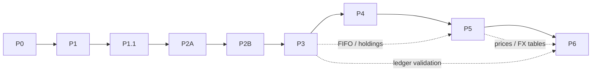

# Merton Labs — Project Plan

The single source of truth for **scope, roadmap, phase status and
acceptance criteria** of the Merton Labs backend (`merton-labs/merton-api`).

- Architecture decisions and their status: [ARCHITECTURE_DECISIONS.md](ARCHITECTURE_DECISIONS.md)
  (cited below as `ADR-…`)
- Agent working rules: [../CLAUDE.md](../CLAUDE.md)
- Running, configuring and testing the service: [../README.md](../README.md)

**Maintenance rule.** When a phase finishes, update §23 (Current
Implementation Status), that phase's **Status** and acceptance checklist in
§17/§18, and §24 (Next Recommended Task) in the same change set. Statuses
must reflect what the code and CI prove, never what is planned.

---

## 1. Executive Summary

Merton Labs is an Apache-2.0, self-hosted, multi-user investment portfolio
tracker inspired by Snowball Analytics. Each user privately manages their
own portfolios: they record transactions and see holdings, cash, FIFO cost
basis, income, valuation in a chosen base currency, and asset allocation.
Data moves in and out through CSV.

This repository is the Rust/Axum REST API. The SvelteKit frontend lives in a
separate repository.

**Status at the time of writing:**

| Phase | Status |
| --- | --- |
| P0 (foundation) | Completed |
| P1 (authentication) | Completed |
| P1.1 (auth hardening) | Completed |
| P2A (portfolios) | Next; not started |

## 2. Product Goals

1. **Financial correctness:**
   - exact decimal arithmetic
   - an authoritative transaction ledger
   - FIFO economic cost basis
   - no fabricated prices or rates
   - explicit partial results
2. **Reasonable security:**
   - server-side sessions
   - CSRF protection
   - rate limiting
   - strict per-user data isolation
3. **Simple self-hosting:** one container, SQLite on a volume, environment
   configuration, no external services.
4. **Maintainability:** a small single-crate codebase, explicit layers,
   tests on every security and financial boundary.

## 3. MVP Scope

| Area | In scope |
| --- | --- |
| Users | Local accounts, sessions, personal portfolios only (ADR-OWN-01) |
| Assets | Thai stocks, international stocks, ETFs, mutual funds, cash, bank deposits (ADR-SCOPE-02) |
| Portfolios | Multiple per user, base currency, active/archived lifecycle, safe delete |
| Instruments | User-scoped, flexible identity, fixed quote currency, typed metadata |
| Cash | Multiple cash accounts per portfolio, one currency each, negative balances allowed |
| Ledger | Transactions with position/cash movements, opening balances, FIFO lots, editable history |
| Transactions | Buy, Sell, Deposit, Withdrawal, Dividend/Distribution, Interest, Fee, Tax, Tax Return, Cash Transfer, FX Exchange, Stock Dividend, Stock Split, Reverse Split |
| Market data | Manually entered or imported historical prices and FX rates |
| Reporting | On-demand valuation at `as_of`, partial valuation, signed allocation by asset class |
| Data exchange | CSV import (transactions, prices, FX rates) and CSV export |

## 4. Explicit Non-goals

From ADR-SCOPE-05 and the transaction rules:

- **Excluded asset classes:** bonds and fixed income; cryptocurrency and
  stablecoins; options, futures and other derivatives.
- **Excluded trading features:** margin engines, brokerage integration,
  order execution.
- **Excluded data features:** automated market-data feeds; advanced
  performance or risk analytics; benchmarks; optimization.
- **Excluded collaboration features:** sharing, collaboration, teams,
  organizations, workspaces, invitations, public portfolios.
- **Excluded auth features:** OAuth or social login, MFA/TOTP, JWT,
  email delivery infrastructure.
- **Excluded tax features:** country-specific tax reporting; automatic fee
  or tax calculation.
- **Deferred corporate actions:** spin-offs, mergers, rights issues,
  return of capital.
- **Excluded import features:** broker-specific CSV adapter frameworks;
  asynchronous import jobs.
- **Excluded infrastructure:** Redis, Kubernetes, message brokers,
  mandatory cloud services, a SvelteKit BFF.
- **Not an MVP dependency:** SabiQuant.

## 5. Technology Stack

| Layer | Technology |
| --- | --- |
| Language | Rust stable, edition 2024, MSRV 1.94 |
| HTTP | Axum 0.8, Tokio, Tower / tower-http |
| API docs | utoipa (OpenAPI), served at `/api/v1/openapi.json` |
| Persistence | SeaORM 2 + SeaORM Migration/SeaQuery; SQLite now, PostgreSQL preferred later |
| Serialization | Serde |
| Logging | tracing + tracing-subscriber |
| Auth crypto | `argon2`, `sha2`, `hmac`, `getrandom`, `base64ct` |
| Decimals | `rust_decimal`: required for financial values, **not yet added** |
| Frontend (separate repo) | SvelteKit, Svelte 5 runes, TypeScript |
| Deployment | Docker multi-stage image, Docker Compose, named volume |
| CI | GitHub Actions: fmt, check, clippy (`-D warnings`), test, all `--locked` |

Exact versions are pinned in `Cargo.toml` and `Cargo.lock`.

## 6. Architecture Overview

- **Shape:** a single-crate, API-first modular monolith (ADR-ARCH-01).
- **Layers:** thin handlers, then use cases, then domain logic and
  repositories (ADR-ARCH-02).
- **Framework independence:** financial logic must not depend on Axum or
  SeaORM.

**Current source layout (implemented):**

```text
src/
├── main.rs                 # .env, tracing, runtime, exit codes
├── lib.rs
├── app.rs                  # AppState, Security, startup, migrations, graceful shutdown
├── config.rs               # env configuration + validation
├── auth/                   # framework-independent authentication logic
│   ├── email.rs  password.rs  session.rs  csrf.rs  rate_limit.rs
│   ├── repository.rs       # SeaORM queries (plain functions)
│   └── service.rs          # register / login / authenticate / logout
├── http/                   # Axum adapters for all features
│   ├── mod.rs              # router, OpenAPI document, layers
│   ├── auth.rs  health.rs  # handlers
│   ├── extract.rs          # ApiJson, ClientIp, TrustedOrigin, CurrentSession, CsrfProtectedSession
│   └── error.rs            # ApiError → RFC 9457 Problem Details
└── infrastructure/
    ├── database.rs         # pool + SQLite pragmas (only SQLite-specific code)
    ├── entities/           # user.rs, user_session.rs
    └── migrations/         # m20261024_000001_create_users, m20261024_000002_create_user_sessions
tests/
├── common/mod.rs           # TestApp harness: isolated in-memory SQLite per test
├── auth.rs  database.rs  http.rs
```

**Module organization** is OPEN (ADR-ARCH-03). Until the owner decides,
new features follow the existing pattern:

- `src/<feature>/` for domain, service and repository code
- `src/http/<feature>.rs` for handlers
- `src/infrastructure/entities/` and `src/infrastructure/migrations/` for
  persistence

**Request flow:**

1. tower-http `TraceLayer`, plus `Cache-Control: no-store` on auth routes
2. extractors (JSON, client IP, origin, session, CSRF)
3. handler
4. service (use case)
5. repository (`&impl ConnectionTrait`)
6. SeaORM / SQLite

## 7. Domain Model Overview

Implemented tables are marked ✅; everything else is planned.

| Entity | Owner | Phase | Notes |
| --- | --- | --- | --- |
| `users` ✅ | — | P1 | `id` UUID, `email`, `normalized_email` UNIQUE, `password_hash` (PHC), timestamps |
| `user_sessions` ✅ | user | P1 | `token_hash` UNIQUE (32-byte SHA-256), `user_id` FK→users (CASCADE), idle/absolute expiry, `revoked_at` |
| `portfolios` | user (immutable) | P2A | name, base currency, status `ACTIVE`/`ARCHIVED`, timestamps |
| `instruments` | user | P2B | asset class, symbol/ISIN/exchange (optional, non-unique), quote currency, typed JSON metadata |
| `cash_accounts` | portfolio | P2B | name, single currency; many per portfolio |
| `transactions` | portfolio | P3/P4 | type, transaction date, `sort_order`, fees/taxes, references to instrument/cash accounts |
| `position_movements` | transaction | P3/P4 | quantity changes per instrument (source of holdings and FIFO lots) |
| `cash_movements` | transaction | P3/P4 | amount changes per cash account (source of balances) |
| `instrument_prices` | via instrument | P5 | date, price, source |
| `fx_rates` | user | P5 | date, base/quote pair, rate, direction explicit |
| import records | user/portfolio | P6 | upload, mapping, row results, audit |

The ledger entities above are a **conceptual baseline**. Their physical
schema is OPEN (ADR-LEDG-02) and must be approved at the start of P3.
Ownership chain: user → portfolio → (cash accounts, transactions →
movements). Instruments, prices and FX rates are user-scoped.

## 8. Authentication and Authorization

**Implemented (P1/P1.1):** see ADR-AUTH-01 … ADR-AUTH-09.

- `POST /api/v1/auth/register`, `POST /login`, `POST /logout`, `GET /me`, `GET /csrf`.
- **Passwords and accounts:**
  - Argon2id, at most `AUTH_MAX_CONCURRENT_HASHES` concurrent operations;
    `503 service_overloaded` when saturated.
  - Dummy-hash verification for unknown accounts.
- **Sessions:**
  - `__Host-merton_session` cookie (HttpOnly, Secure, SameSite=Lax).
  - 7-day sliding / 30-day absolute expiry; activity written at most every
    15 minutes; server-side revocation.
- **CSRF:** trusted-Origin check on mutations, plus an HMAC `X-CSRF-Token`
  for authenticated mutations.
- **Rate limits:** atomic per-IP (20 / 15 min) and per-account
  (5 failed / 15 min).

**Authorization rules for every future feature** (ADR-OWN-01 … OWN-05):

1. Identity comes only from `CurrentSession` or `CsrfProtectedSession`.
   Owner-scoped code receives `auth::UserId`.
2. Every authenticated mutation uses `CsrfProtectedSession`.
3. Queries are owner-scoped. Related IDs in a request, such as instrument
   or cash-account IDs, are validated to belong to the same owner and
   portfolio.
4. Another user's resource returns `404 not_found`, exactly like a missing
   one.
5. Each phase adds cross-user integration tests.

**Not implemented:** account recovery (ADR-AUTH-10) and session cleanup
(ADR-AUTH-11).

## 9. Financial Ledger Rules

Summary of ADR-LEDG-01 … LEDG-10 and ADR-TXN-01 … TXN-07:

- **Source of truth:** the ledger. Holdings come from position movements
  and cash balances from cash movements. Neither is stored
  authoritatively.
- **Atomic writes:** a transaction and its movements are written, edited
  or deleted together, in one database transaction.
- **Positions:** FIFO economic cost basis, long-only. A holding that goes
  negative at any historical point is rejected.
- **Cash:** negative balances are allowed. A portfolio may have several
  cash accounts, including several in the same currency; each account has
  one currency.
- **Settlement:** a trade settles in the selected cash account's currency.
  The cash movement for a buy or sell is optional.
- **Opening balances:**
  - opening positions (one or many FIFO lots) without cash
  - an opening cash balance as a transaction
- **Ordering:** by transaction date, then `sort_order`. No settlement date.
- **Corrections:** direct edit or delete, followed by atomic FIFO replay
  and validation. Invalid results are rejected. The ledger is not
  append-only.
- **Fees and taxes:** entered manually, original amounts preserved, in the
  settlement currency. Included in cost basis and net proceeds. Economic
  cost basis only; no tax engine.
- **FX exchange:** records executed amounts and rate, kept separate from
  market FX rates. Fees are not included in principal.
- **Corporate actions:**
  - stock dividends spread cost basis across the resulting lots
  - splits preserve total cost
  - cash in lieu realizes P/L on the allocated fractional cost
  - details are OPEN (ADR-TXN-07)

## 10. Financial Precision and Rounding

ADR-NUM-01 … NUM-05:

- **Types:**
  - `rust_decimal::Decimal` for all exact values; never `f32`/`f64` or SQLite `REAL`.
  - Money, quantity, price and rate are distinct types.
- **Storage:**
  - Canonical decimal **TEXT** in SQLite (scaled INTEGER only where
    explicitly defined).
  - Verify SeaORM's SQLite mapping before relying on it.
  - No SQL aggregation over decimal text; aggregate in Rust.
- **JSON:** decimals are sent and received as **strings**.
- **Rounding:** input precision is preserved. There is no arbitrary
  intermediate rounding; rounding happens only at defined boundaries, and
  overflow is checked.
- **OPEN:** precision limits per kind, currency minor units, and
  per-operation rounding modes. Decide before P2B (limits) and P3/P4
  (rounding).

## 11. Market Data and FX

- **Prices:**
  - Historical instrument prices are entered manually or imported (no
    automated feeds).
  - Each price has a date and a source.
- **FX rates:**
  - Historical FX rates are user-scoped. Direct and inverse pairs are
    supported; there is no cross-rate triangulation.
  - The quote direction is explicit in the schema and the API.
- **Lookup:** the latest value on or before `as_of`. A current rate is
  never used for an old date.
- **Executed rates:** rates from FX Exchange transactions are never used
  as market rates.

## 12. Valuation and Allocation

ADR-VAL-01 … VAL-05:

- **When:** on demand, for an explicit `as_of` date; nothing authoritative
  is stored.
- **What each valued position reports:**
  - the price date and source
  - stale-data indicators (the threshold is OPEN)
  - the FX rate used
- **Missing data:**
  - The result is marked partial.
  - Valued totals are reported separately from unvalued assets, with
    reasons.
  - Missing assets are never valued at zero.
- **Allocation:**
  - Classes: `STOCK`, `ETF`, `MUTUAL_FUND`, `CASH`.
  - Market value in base currency divided by Net Portfolio Value; signed.
  - NPV ≤ 0 gives `null` percentages.
  - Negative cash is flagged, not treated as a margin loan.
  - A partial valuation is never presented as a complete allocation.
- **Base currency:** a change re-values on demand (ADR-PORT-02).

## 13. CSV Import/Export

ADR-CSV-01 … CSV-05, ADR-INST-05:

- **Import types:** transactions, instrument prices, FX rates.
- **Workflow:** upload → preview → map → validate → resolve → commit,
  synchronous. Limits: 20 MB and 50,000 rows.
- **Mapping:** dynamic column mapping; configurable date and decimal
  formats.
- **Validation:** errors reported per row.
- **Instruments:** never created automatically. Unambiguous matches are
  applied automatically; ambiguous ones go to user review.
- **Duplicates:**
  - source-scoped external IDs for confirmed matches
  - fingerprints for potential duplicates
  - explicit user review; never auto-merged with manual entries
- **Commit:** the selected valid rows are committed atomically after FIFO
  and ledger revalidation.
- **Export:** respects ownership. Cells must be escaped against spreadsheet
  formula injection (§21).
- **Known risk:** large synchronous imports may hit request timeouts and
  long write locks on SQLite. Measure during P6.

## 14. API Contract Standards

ADR-API-01 … API-06:

- **Basics:**
  - REST under `/api/v1`, documented in OpenAPI via utoipa.
  - Success bodies are plain JSON.
  - Errors are RFC 9457 `application/problem+json` with a stable `code`.
- **Status codes:**

  | Code | Meaning |
  | --- | --- |
  | 200 | success |
  | 201 | created |
  | 204 | no content / deleted |
  | 400 | malformed request |
  | 401 | unauthenticated |
  | 403 | CSRF failure or forbidden operation |
  | 404 | missing or inaccessible resource |
  | 409 | conflicting state |
  | 415 | wrong content type |
  | 422 | validation failure |
  | 429 | rate limited (`Retry-After`) |
  | 503 | temporary overload (`Retry-After`) |
  | 500 | unexpected error |

- **Pagination:**
  - `limit` and `offset`, with a stable order and a unique tie-breaker.
  - Page-size limits are OPEN; proposed default 50, max 200.
- **Request rules:**
  - Decimals are JSON strings.
  - Request bodies never carry an owner identity.
  - Authenticated mutations need the session cookie and `X-CSRF-Token`.
- **Error content:** no stack traces, SQL errors, secrets or other users'
  data in any response.

## 15. Implementation Roadmap

| ID | Phase | Status |
| --- | --- | --- |
| **P0** | Project Foundation | ✅ Completed (`e67300d`, CI green) |
| **P1** | Authentication & Session Management | ✅ Completed (`10a35ac`, CI green) |
| **P1.1** | Authentication Security Hardening | ✅ Completed (`8e646a1`, CI green) |
| **P2A** | Portfolio CRUD & Ownership | ⏳ Not started (next) |
| **P2B** | Instruments & Cash Accounts | Not started |
| **P3** | Transaction Ledger & FIFO | Not started |
| **P4** | Financial Transactions & Corporate Actions | Not started |
| **P5** | Valuation, FX & Asset Allocation | Not started |
| **P6** | CSV Import & Export | Not started |

Phases are implemented in order. Do not merge phases, and do not pull
later-phase work forward. The backend MVP is functionally complete only
when P6's acceptance criteria pass. Frontend integration is a separate
workstream that can start once the API milestones it needs are stable.

## 16. Phase Dependencies



| Phase | Hard prerequisites | Decisions needed before starting |
| --- | --- | --- |
| P2A | P1.1 | ADR-ARCH-03 (or explicit OK to keep hybrid), ADR-API-04 page size, ADR-PORT-03 archived-update rule |
| P2B | P2A | ADR-INST-04 bank deposits, ADR-NUM-02/04 decimal storage & limits |
| P3 | P2B | ADR-LEDG-02 physical schema, ADR-LEDG-08 `sort_order`, ADR-NUM-05 rounding (for trades) |
| P4 | P3 | ADR-TXN-01 Tax Return, ADR-TXN-04 fee placement, ADR-TXN-07 corporate-action allocation |
| P5 | P3, P4 | ADR-VAL-02 staleness threshold |
| P6 | P3, P4, P5 | ADR-CSV-02 staging model |

## 17. Phase Deliverables

Every phase uses the same template. **Expected modules/files** for
P2A onward are illustrative and follow the current hybrid layout; they
change if ADR-ARCH-03 is decided differently. **Endpoint paths** for
P2A onward are *Proposed* until they are implemented.

### P0 — Project Foundation
- **Status:** ✅ Completed. Evidence: commit `e67300d`; CI green.
- **Objective:** a compilable, tested service skeleton.
- **Dependencies:** none.
- **Scope and deliverables:**
  - the Cargo project, configuration from env, structured logging and
    graceful shutdown
  - a SeaORM SQLite pool (FK, WAL, busy timeout) and migration
    infrastructure
  - OpenAPI, the Dockerfile and Compose, GitHub Actions CI
  - `GET /api/v1/health`, which pings the database: `200 ok`, or
    `503 unavailable`
- **Files:** `src/{main,lib,app,config}.rs`, `src/http/{mod,health}.rs`,
  `src/infrastructure/{database.rs,migrations/}`, `Dockerfile`,
  `compose.yaml`, `.github/workflows/ci.yml`.
- **Tests:** health, OpenAPI document, 404 fallback, `PRAGMA foreign_keys = 1`,
  migration table exists, config parsing.
- **Excluded:** business features.

### P1 — Authentication & Session Management
- **Status:** ✅ Completed. Evidence: commit `10a35ac`; CI green.
- **Objective:** secure local accounts and server-managed sessions.
- **Dependencies:** P0.
- **Deliverables:**
  - `users` and `user_sessions` migrations and entities
  - register, login, logout, me, csrf endpoints
  - the extractors `CurrentSession`, `CsrfProtectedSession`,
    `TrustedOrigin` and `ClientIp`
  - Problem Details errors and the rate limiter
- **Database:** `users.normalized_email` UNIQUE; `user_sessions.token_hash`
  UNIQUE; `idx_user_sessions_user_id`; FK `user_sessions.user_id → users.id`
  `ON DELETE CASCADE`.
- **Tests:**
  - registration: success, duplicate, normalization, invalid input, hashing
  - login: success, wrong password, unknown email, rate limits, cookie
    attributes
  - sessions: idle and absolute expiry, revocation, sliding expiry, logout
  - security: CSRF, origin checks, invalid tokens, identity override,
    isolation between two users, database uniqueness and FK constraints
- **Excluded:** OAuth, MFA, JWT, account recovery, email delivery.

### P1.1 — Authentication Security Hardening
- **Status:** ✅ Completed. Evidence: commit `8e646a1`; CI green.
- **Objective:** close the rate-limit race and the unbounded Argon2 concurrency.
- **Dependencies:** P1.
- **Deliverables:**
  - an atomic `FixedWindowLimiter::acquire`
  - account-slot reservation before verification
  - per-IP budget consumed first
  - lowest-count-first eviction
  - `Retry-After` rounded up
  - `HashLimiter` / `HashPermit` (Tokio semaphore, `try_acquire`, permit
    moved into `spawn_blocking`)
  - `AUTH_MAX_CONCURRENT_HASHES` (default 4, range 1–64)
  - `503 service_overloaded`, documented in OpenAPI
- **Tests:**
  - 64-thread barrier tests for the IP and account limits and the key bound
  - permit limit, release on success and on panic
  - a cancelled request keeps its permit until the computation finishes
  - 503 uniform for known, unknown and malformed accounts
  - overload does not consume the account budget
  - multi-threaded HTTP concurrency tests
- **Excluded:** distributed rate limiting, CIDR proxies, account recovery,
  session cleanup.

### P2A — Portfolio CRUD & Ownership
- **Status:** ⏳ Not started (next recommended task).
- **Objective:** private portfolios with enforced ownership. This
  establishes the owner-scoping pattern every later feature reuses.
- **Dependencies:** P1.1. The decisions in §16 must be made first.
- **Scope:** create, list, get, update (name, base currency), archive,
  restore, delete-if-empty.
- **Expected files:**
  - `src/portfolios/{mod,service,repository}.rs` (domain types and rules)
  - `src/http/portfolios.rs`
  - `src/infrastructure/entities/portfolio.rs`
  - `src/infrastructure/migrations/m<date>_create_portfolios.rs`
  - `tests/portfolios.rs`
- **Database:** a `portfolios` table:
  - columns: `id` UUID PK, `owner_user_id` FK→`users.id`
    (`ON DELETE RESTRICT`), `name`, `base_currency` (3-letter code),
    `status` (`ACTIVE`/`ARCHIVED`), `created_at`, `updated_at`
  - an index on `owner_user_id`
  - no column lets the owner change
- **API (Proposed):**

  | Method & path | Purpose | Returns |
  | --- | --- | --- |
  | `POST /api/v1/portfolios` | create | 201 |
  | `GET /api/v1/portfolios?limit&offset&status` | list owned | 200, stable order |
  | `GET /api/v1/portfolios/{id}` | get | 200 / 404 |
  | `PATCH /api/v1/portfolios/{id}` | update name, base currency | 200 / 404 / 409 / 422 |
  | `POST /api/v1/portfolios/{id}/archive` | archive | 200 / 404 / 409 |
  | `POST /api/v1/portfolios/{id}/restore` | restore | 200 / 404 / 409 |
  | `DELETE /api/v1/portfolios/{id}` | delete | 204 / 404 / 409 |

  All mutations use `CsrfProtectedSession`. Owner identity is never
  accepted from the request.
- **Validation:**
  - name: trimmed, non-empty, max length to be fixed in implementation
  - base currency: a 3-letter uppercase code. Whether to validate against
    the full ISO 4217 list is to be confirmed.
- **Delete rule:** allowed only without financial history. P2A has no
  financial tables yet, but the delete use case must be built so that
  later phases add their checks to it (ADR-PORT-04).
- **Tests:**
  - **CRUD and lifecycle:** each operation, archive/restore transitions,
    and invalid transitions (409)
  - **Validation:** name and currency rules (422)
  - **Pagination:** order is stable; limits are enforced
  - **Cross-user:** user B gets 404 on get, update, archive, restore and
    delete of A's portfolio, and B's list never contains A's portfolios
  - **Request identity:** `owner_user_id` in the body is ignored or
    rejected
  - **CSRF:** every mutation without a CSRF token is rejected (403)
  - **OpenAPI:** the document contains every new path and schema
  - **Migration:** applied on a fresh database
- **Acceptance:** see §18.
- **Excluded:** cash accounts, instruments, transactions, valuation, and
  any decimal financial values.

### P2B — Instruments & Cash Accounts
- **Status:** Not started.
- **Objective:** the reference data the ledger needs.
- **Dependencies:** P2A. Decisions ADR-INST-04 and ADR-NUM-02/04 must be
  made first.
- **Scope:**
  - user-scoped instruments: asset class, optional symbol/ISIN/exchange,
    fixed quote currency, typed JSON metadata, duplicates allowed
  - cash accounts per portfolio: name and one currency, with many per
    portfolio allowed
  - ownership consistency and currency validation
- **Expected files:**
  - `src/instruments/`, `src/cash_accounts/` (or one module if ADR-ARCH-03 says so)
  - `src/http/{instruments,cash_accounts}.rs`
  - entities and migrations
  - `tests/{instruments,cash_accounts}.rs`
  - `rust_decimal` is introduced here if any decimal field is needed
- **Database:**
  - `instruments`: `owner_user_id` FK, no uniqueness on symbol or ISIN
  - `cash_accounts`: `portfolio_id` FK `RESTRICT`
- **API (Proposed):**
  - `/api/v1/instruments` CRUD
  - `/api/v1/portfolios/{id}/cash-accounts` CRUD
  - cash-account mutations are rejected when the portfolio is `ARCHIVED`
- **Tests:** CRUD, validation, duplicate identities allowed, cross-user 404
  for both resources, a cash account cannot attach to another user's
  portfolio, archived-portfolio rules, and the delete rules (instrument or
  account in use → 409, once P3 exists).
- **Excluded:** prices, FX rates, transactions.

### P3 — Transaction Ledger & FIFO
- **Status:** Not started.
- **Objective:** an authoritative ledger with FIFO cost basis.
- **Dependencies:** P2B. Decisions ADR-LEDG-02, ADR-LEDG-08 and ADR-NUM-05
  must be made first.
- **Scope:**
  - `transactions`, `position_movements` and `cash_movements`
  - opening positions (multi-lot) and opening cash balance
  - Buy and Sell with optional cash movement
  - FIFO lot computation as a pure Rust domain module
  - ordering by date and `sort_order`
  - edit and delete with atomic replay and validation
  - extending the portfolio delete check to the new tables
- **Expected files:**
  - `src/ledger/` with `fifo.rs` (pure, no SeaORM or Axum), `service.rs`
    and `repository.rs`
  - `src/http/transactions.rs`
  - migrations and `tests/ledger.rs`
- **Database:** foreign keys to portfolio, instrument and cash account use
  `RESTRICT`, with indexes for replay order (`portfolio_id`, date,
  `sort_order`).
- **API (Proposed):** `/api/v1/portfolios/{id}/transactions` (list, create,
  get, update, delete), with mutations rejected on `ARCHIVED` portfolios.
- **Tests:**
  - FIFO unit tests: partial lots, multiple lots, fees in cost basis, net
    proceeds
  - negative holdings rejected, including through a historical edit
  - negative cash allowed
  - atomic rollback when a movement write fails
  - ordering ties
  - cross-user and cross-portfolio references rejected
  - decimal round-trip through the database without precision loss
- **Excluded:** income, transfers, FX, corporate actions, valuation.

### P4 — Financial Transactions & Corporate Actions
- **Status:** Not started.
- **Objective:** the remaining MVP transaction types.
- **Dependencies:** P3. Decisions ADR-TXN-01, TXN-04 and TXN-07 must be
  made first.
- **Scope:**
  - Deposit, Withdrawal, Dividend/Distribution, Interest
  - Fee, Tax, Tax Return
  - Cash Transfer (balanced movements) and FX Exchange (executed amounts
    and rate, fees separate)
  - Stock Dividend, Stock Split, Reverse Split, fractional shares, cash in
    lieu
  - all with atomic movement posting
- **Tests:**
  - per-type posting and invariant tests
  - split and reverse split preserve total cost
  - stock-dividend cost reallocation
  - cash in lieu realizes P/L
  - transfer balance is preserved
  - executed FX rates never leak into market FX
  - edits replay correctly
- **Excluded:** spin-offs, mergers, rights issues, return of capital, and
  tax reporting.

### P5 — Valuation, FX & Asset Allocation
- **Status:** Not started.
- **Objective:** on-demand portfolio valuation in the base currency.
- **Dependencies:** P3 and P4. Decision ADR-VAL-02 must be made first.
- **Scope:**
  - price and FX-rate storage and CRUD
  - holdings and cash balances at `as_of`
  - valuation with price and FX lookup on or before `as_of`, with
    staleness indicators and partial results
  - signed allocation
  - base-currency re-valuation
- **API (Proposed):**
  - `/api/v1/instruments/{id}/prices`
  - `/api/v1/fx-rates`
  - `GET /api/v1/portfolios/{id}/holdings?as_of=`
  - `GET /api/v1/portfolios/{id}/valuation?as_of=`
  - `GET /api/v1/portfolios/{id}/allocation?as_of=`
- **Tests:**
  - lookup on or before `as_of`, with no future leakage
  - inverse FX
  - no triangulation
  - partial valuation with reasons
  - the allocation example (125% / −25%)
  - NPV ≤ 0 gives null
  - a base currency change does not alter transactions
- **Excluded:** automated feeds, benchmarks, performance and risk analytics.

### P6 — CSV Import & Export
- **Status:** Not started.
- **Objective:** bulk data in and out, safely.
- **Dependencies:** P3, P4 and P5. Decision ADR-CSV-02 must be made first.
- **Scope:**
  - **Workflow:** upload, mapping, preview, validation, instrument
    matching, duplicate detection, conflict resolution, then an atomic
    commit of the selected rows with ledger revalidation
  - **Export:** CSV
  - **Audit:** import audit records
  - **Limits:** 20 MB and 50,000 rows
- **Tests:**
  - **Atomicity:** partial failure commits nothing
  - **Correctness:** revalidation rejects imports that break FIFO
  - **Duplicates:** external-ID and fingerprint detection
  - **Instruments:** ambiguous instruments require review; no
    auto-creation
  - **Ownership:** cross-user isolation for both import and export
  - **Limits:** size and row-count limits enforced
  - **Security:** formula-injection escaping on export
- **Excluded:** broker adapters, asynchronous jobs.

## 18. Acceptance Criteria

**Every phase** (the Definition of Done, also in [CLAUDE.md](../CLAUDE.md)):

- [ ] All four CI commands pass locally and in CI.
- [ ] New behaviour has tests in the same phase, including cross-user tests
      for owned resources.
- [ ] OpenAPI documents every new or changed endpoint, request, response
      and error.
- [ ] Migrations apply cleanly on a fresh database; no committed migration
      was edited.
- [ ] No secrets, password hashes, tokens or other users' data appear in
      logs or responses.
- [ ] README, this plan, and ARCHITECTURE_DECISIONS updated where affected.

**Phase-specific criteria:**

- **P0 ✅:** the server starts; health returns 200; Docker Compose runs
  with persistent data.
- **P1 ✅:** all auth endpoints behave as specified; sessions expire and
  revoke server-side; CSRF and origin checks enforced; rate limits return
  429.
- **P1.1 ✅:**
  - no more than N attempts are accepted under concurrency
  - Argon2 concurrency is bounded
  - a cancelled request does not release a permit early
  - overload returns 503 uniformly
- **P2A:**
  - [ ] The owner comes only from the session.
  - [ ] Another user's portfolio is indistinguishable from a missing one
        (404).
  - [ ] Archive and restore follow ADR-PORT-03.
  - [ ] Delete is gated by the financial-history check.
  - [ ] List pagination is stable and bounded.
- **P2B:**
  - [ ] Instruments and cash accounts are owner-consistent.
  - [ ] Currency is validated.
  - [ ] Duplicate instrument identities are allowed.
- **P3:**
  - [ ] Holdings and cash are derived, never stored authoritatively.
  - [ ] FIFO is correct.
  - [ ] Invalid negative holdings are impossible, including through edits.
  - [ ] All ledger writes are atomic.
  - [ ] Decimals are exact end to end.
- **P4:**
  - [ ] Every MVP transaction type posts correct movements.
  - [ ] Corporate-action cost rules hold.
  - [ ] Executed FX is separate from market FX.
- **P5:**
  - [ ] Valuation at `as_of` uses only data on or before that date.
  - [ ] Partial results are explicit.
  - [ ] Allocation is signed, with NPV ≤ 0 giving null.
- **P6:**
  - [ ] Imports are atomic and revalidated.
  - [ ] Duplicates go to review.
  - [ ] Limits are enforced.
  - [ ] Export is owner-scoped and injection-safe.

## 19. Testing Strategy

The strategy is risk-based testing with incremental development (ADR-QA-01).

| Layer | How | Where |
| --- | --- | --- |
| Domain/unit | Pure functions, no DB/HTTP; time passed in explicitly | `#[cfg(test)]` in `src/**` |
| HTTP integration | `tests/common::TestApp` + `tower::ServiceExt::oneshot`; `ConnectInfo` inserted per request | `tests/*.rs` |
| SQLite integration | Fresh in-memory DB per test (single connection), migrations applied | `tests/common::test_db` |
| Security | CSRF, origin, session expiry/revocation, cross-user 404 | per feature |
| Financial invariants | FIFO, non-negative holdings, exact decimals, atomic rollback | P3+ |
| Concurrency | `std::sync::Barrier` threads / channels; multi-thread Tokio tests; no sleeps | where shared state exists |
| OpenAPI | Assert paths, schemas, security schemes exist | `tests/http.rs` |
| Migrations | Fresh-DB apply; constraint behaviour | `tests/database.rs` |

Current suite at `8e646a1`: **92 tests** (49 unit + 43 integration). All pass.

Commands:

```bash
cargo fmt --all -- --check
cargo check --all-targets --locked
cargo clippy --all-targets --locked -- -D warnings
cargo test --locked
```

Argon2 and blake2 are built with `opt-level = 3` in the dev profile, which
keeps auth tests fast. Clippy denies `unwrap_used`/`expect_used` outside
tests, and `unsafe_code` is forbidden.

## 20. Deployment and Operations

- **Configuration:** environment variables; see the
  [README](../README.md#configuration) for the current list.
  - `APP_SECRET_KEY` is required (at least 32 bytes) and must stay stable.
  - Behind a reverse proxy, set `APP_TRUSTED_ORIGINS` to the public origin
    and `TRUSTED_PROXIES` to the proxy IP, and keep
    `SESSION_COOKIE_SECURE=true`.
- **Startup:** config validation, then DB connect, then migrations, then
  listen. Invalid configuration exits non-zero.
- **Docker:** a multi-stage image running as non-root uid 10001. The
  `merton-data` volume is mounted at `/app/data`. The port is published on
  `127.0.0.1:8080`, and graceful SIGTERM shutdown is verified.
- **Topology:** same-origin reverse proxy (`/` → SvelteKit, `/api/*` →
  Axum), single instance (rate limits are process-local).
- **Backups:** copy the SQLite database from the volume. Because WAL mode
  is used, either stop the container or use SQLite's online backup.
  Back-up tooling is not provided yet.

## 21. Security Risks

| Risk | Status / mitigation |
| --- | --- |
| No account recovery | OPEN (ADR-AUTH-10); operators must manage accounts in the DB |
| Expired/revoked sessions accumulate | OPEN (ADR-AUTH-11) |
| Rate limits are process-local, reset on restart, fixed-window (up to 2× burst at boundaries) | Accepted for single-instance MVP |
| Successful login clears in-flight failure slots; reveals owner sign-in to an attacker with recorded failures | Accepted residual (low) |
| Key-table flood (10,000 keys all exhausted) can evict an exhausted entry | Accepted residual (lowest-count eviction first) |
| Overload (503) also affects legitimate sign-ins | Accepted; protects memory/CPU, not availability against large botnets |
| `TRUSTED_PROXIES` exact IPs only (no CIDR) | Follow-up |
| Requests without `Origin`/`Sec-Fetch-Site` treated as non-browser | Accepted; relies on modern browsers sending `Origin` |
| Registration reveals existing emails (409) | Accepted by contract (ADR-AUTH-09) |
| Passwords not zeroized in memory | Accepted residual |
| IDOR on new resources | Mitigate with owner-scoped queries + cross-user tests every phase (ADR-OWN-03/05) |
| Decimal precision loss via SQLite affinity or float | Mitigate per ADR-NUM-01/02; round-trip tests in P2B/P3 |
| CSV formula injection on export | Must escape in P6 |
| Large synchronous imports (timeouts, long write locks) | Measure and bound in P6 |

## 22. Open Questions

These need project-owner decisions. Do not resolve them silently in code;
the IDs refer to [ARCHITECTURE_DECISIONS.md](ARCHITECTURE_DECISIONS.md#16-open-decisions-summary).

1. **ADR-ARCH-03:** feature-first vs layer-first, or keep the current
   hybrid?
2. **ADR-API-04:** default and maximum page size (proposed 50/200).
3. **ADR-PORT-03:** may archived portfolios be renamed or have their base
   currency changed?
4. **ADR-PORT-04:** does a cash account with no movements count as
   "financial history" for portfolio deletion?
5. **P2A validation:** validate base currency against the full ISO 4217
   list, or by format only?
6. **ADR-INST-04:** how are bank deposits represented, including
   fixed-term deposits?
7. **ADR-NUM-02/04:** decimal column storage, and precision limits per
   numeric kind and currency minor units.
8. **ADR-LEDG-02:** the physical ledger schema.
9. **ADR-LEDG-08:** `sort_order` semantics.
10. **ADR-NUM-05:** rounding mode and scale for each operation.
11. **ADR-TXN-01:** modelling of Tax Return.
12. **ADR-TXN-04:** fee placement for transfers and FX exchanges.
13. **ADR-TXN-07:** stock-dividend and cash-in-lieu allocation and rounding.
14. **ADR-VAL-02:** price and FX staleness threshold.
15. **ADR-CSV-02:** import staging model.
16. **Performance:** limits for ledger replay on large portfolios.
17. **ADR-AUTH-10 / AUTH-11:** account recovery and session cleanup, and
    their timing before production use.

## 23. Current Implementation Status

Verified against the source, the tests and GitHub Actions at commit
`8e646a1` on `main`.

| Area | Status | Evidence |
| --- | --- | --- |
| P0 foundation | ✅ Done | `src/app.rs`, `src/config.rs`, `src/infrastructure/database.rs`, `Dockerfile`, `compose.yaml`, CI green on `e67300d` |
| Health + OpenAPI | ✅ Done | `GET /api/v1/health`, `GET /api/v1/openapi.json`; `tests/http.rs` |
| Users, sessions | ✅ Done | migrations `m20261024_000001/2`; `src/infrastructure/entities/{user,user_session}.rs` |
| Auth endpoints | ✅ Done | `src/http/auth.rs` (register, login, logout, me, csrf) |
| CSRF / origin / extractors | ✅ Done | `src/auth/csrf.rs`, `src/http/extract.rs` |
| Rate limiting (atomic) | ✅ Done | `src/auth/rate_limit.rs` |
| Bounded Argon2 | ✅ Done | `src/auth/password.rs` (`HashLimiter`, `HashPermit`), `AUTH_MAX_CONCURRENT_HASHES` |
| Problem Details | ✅ Done | `src/http/error.rs` |
| Tests | ✅ 92 passing | `cargo test --locked`; CI green on `8e646a1` |
| Portfolios (P2A) | ❌ Not started | no `portfolios` table, entity or routes |
| Instruments, cash accounts (P2B) | ❌ Not started | — |
| Ledger, FIFO (P3) | ❌ Not started | — |
| Financial transactions (P4) | ❌ Not started | — |
| Valuation, FX (P5) | ❌ Not started | — |
| CSV (P6) | ❌ Not started | — |
| `rust_decimal` | ❌ Not added | not in `Cargo.toml` |
| Account recovery, session cleanup | ❌ Not started | ADR-AUTH-10/11 open |

## 24. Next Recommended Task

**P2A — Portfolio CRUD & Ownership.**

Prerequisites:

1. Get owner decisions on open questions 1–5 (§22). At minimum, the owner
   must explicitly approve or reject keeping the current hybrid module
   layout.
2. Start from a clean `main` with CI green.
3. Read this plan, ARCHITECTURE_DECISIONS.md and CLAUDE.md, then the
   existing auth code. In particular, read `src/http/extract.rs` (session
   and CSRF extractors) and `src/auth/mod.rs` (`UserId`).

Implementation outline, in order:

1. Write the migration and the entity.
2. Write the domain validation: name and currency.
3. Write the owner-scoped repository functions. Every query filters by
   `owner_user_id`.
4. Write the service: lifecycle transitions and a delete guard that later
   phases can extend.
5. Write the handlers, using `CurrentSession` for reads and
   `CsrfProtectedSession` for mutations.
6. Add the OpenAPI annotations.
7. Write the tests listed in §17 P2A, including cross-user tests.
8. Update the README, §23 and §24.

Out of scope for P2A: any financial values, cash accounts, instruments or
transactions.
