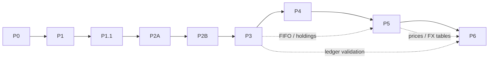

# Merton Labs — Project Plan

The single source of truth for **scope, roadmap, phase status and
acceptance criteria** of the Merton Labs backend (`merton-labs/merton-api`).

- Architecture decisions and their status: [ARCHITECTURE_DECISIONS.md](ARCHITECTURE_DECISIONS.md)
  (cited below as `ADR-…`)
- Agent working rules: [../CLAUDE.md](../CLAUDE.md)
- Running, configuring and testing the service: [../README.md](../README.md)

**Maintenance rule.** When a phase finishes, update §23 (Current
Implementation Status), that phase's **Status** and acceptance checklist in
§17/§18, and §24 (Next Recommended Task) in the same change set. Statuses
must reflect what the code and CI prove, never what is planned.

---

## 1. Executive Summary

Merton Labs is an Apache-2.0, self-hosted, multi-user investment portfolio
tracker inspired by Snowball Analytics. Each user privately manages their
own portfolios: they record transactions and see holdings, cash, FIFO cost
basis, income, valuation in a chosen base currency, and asset allocation.
Data moves in and out through CSV.

This repository is the Rust/Axum REST API. The SvelteKit frontend lives in a
separate repository.

**Status at the time of writing:**

| Phase | Status |
| --- | --- |
| P0 (foundation) | Completed |
| P1 (authentication) | Completed |
| P1.1 (auth hardening) | Completed |
| P2A (portfolios) | Completed (`c5e812d`, CI green; decisions confirmed 2026-10-31) |
| P2B (instruments, cash accounts) | Completed (`04bb1b9`, CI green; one decision provisional, ADR-INST-02) |
| P3 (ledger, FIFO) | Completed (`fc538e1`, CI green; decisions confirmed 2026-10-31 except two details, see §22) |
| P4 (financial transactions, corporate actions) | Completed (PR #1, merge `725023d`, CI green (run 41078791140); two corporate-action rules provisional, see §22) |
| P5 (valuation, FX, allocation) | Completed: storage in PR #1; holdings, valuation and allocation in PR #2, merge `67c3d1d`, CI green (run 41083764335) |

## 2. Product Goals

1. **Financial correctness:**
   - exact decimal arithmetic
   - an authoritative transaction ledger
   - FIFO economic cost basis
   - no fabricated prices or rates
   - explicit partial results
2. **Reasonable security:**
   - server-side sessions
   - CSRF protection
   - rate limiting
   - strict per-user data isolation
3. **Simple self-hosting:** one container, SQLite on a volume, environment
   configuration, no external services.
4. **Maintainability:** a small single-crate codebase, explicit layers,
   tests on every security and financial boundary.

## 3. MVP Scope

| Area | In scope |
| --- | --- |
| Users | Local accounts, sessions, personal portfolios only (ADR-OWN-01) |
| Assets | Thai stocks, international stocks, ETFs, mutual funds, cash, bank deposits (ADR-SCOPE-02) |
| Portfolios | Multiple per user, base currency, active/archived lifecycle, safe delete |
| Instruments | User-scoped, flexible identity, fixed quote currency, typed metadata |
| Cash | Multiple cash accounts per portfolio, one currency each, negative balances allowed |
| Ledger | Transactions with position/cash movements, opening balances, FIFO lots, editable history |
| Transactions | Buy, Sell, Deposit, Withdrawal, Dividend/Distribution, Interest, Fee, Tax, Tax Return, Cash Transfer, FX Exchange, Stock Dividend, Stock Split, Reverse Split |
| Market data | Manually entered or imported historical prices and FX rates |
| Reporting | On-demand valuation at `as_of`, partial valuation, signed allocation by asset class |
| Data exchange | CSV import (transactions, prices, FX rates) and CSV export |

## 4. Explicit Non-goals

From ADR-SCOPE-05 and the transaction rules:

- **Excluded asset classes:** bonds and fixed income; cryptocurrency and
  stablecoins; options, futures and other derivatives.
- **Excluded trading features:** margin engines, brokerage integration,
  order execution.
- **Excluded data features:** automated market-data feeds; advanced
  performance or risk analytics; benchmarks; optimization.
- **Excluded collaboration features:** sharing, collaboration, teams,
  organizations, workspaces, invitations, public portfolios.
- **Excluded auth features:** OAuth or social login, MFA/TOTP, JWT,
  email delivery infrastructure.
- **Excluded tax features:** country-specific tax reporting; automatic fee
  or tax calculation.
- **Deferred corporate actions:** spin-offs, mergers, rights issues,
  return of capital.
- **Excluded import features:** broker-specific CSV adapter frameworks;
  asynchronous import jobs.
- **Excluded infrastructure:** Redis, Kubernetes, message brokers,
  mandatory cloud services, a SvelteKit BFF.
- **Not an MVP dependency:** SabiQuant.

## 5. Technology Stack

| Layer | Technology |
| --- | --- |
| Language | Rust stable, edition 2024, MSRV 1.94 |
| HTTP | Axum 0.8, Tokio, Tower / tower-http |
| API docs | utoipa (OpenAPI), served at `/api/v1/openapi.json` |
| Persistence | SeaORM 2 + SeaORM Migration/SeaQuery; SQLite now, PostgreSQL preferred later |
| Serialization | Serde |
| Logging | tracing + tracing-subscriber |
| Auth crypto | `argon2`, `sha2`, `hmac`, `getrandom`, `base64ct` |
| Decimals | `rust_decimal` 1.43 (added in P3), required for financial values |
| Frontend (separate repo) | SvelteKit, Svelte 5 runes, TypeScript |
| Deployment | Docker multi-stage image, Docker Compose, named volume |
| CI | GitHub Actions: fmt, check, clippy (`-D warnings`), test, all `--locked` |

Exact versions are pinned in `Cargo.toml` and `Cargo.lock`.

## 6. Architecture Overview

- **Shape:** a single-crate, API-first modular monolith (ADR-ARCH-01).
- **Layers:** thin handlers, then use cases, then domain logic and
  repositories (ADR-ARCH-02).
- **Framework independence:** financial logic must not depend on Axum or
  SeaORM.

**Current source layout (implemented):**

```text
src/
├── main.rs                 # .env, tracing, runtime, exit codes
├── lib.rs
├── app.rs                  # AppState, Security, startup, migrations, graceful shutdown
├── config.rs               # env configuration + validation
├── portfolios/             # portfolio domain types, owner-scoped repository, service
├── instruments/            # instrument types (asset class, ISIN), owner-scoped repository, service
├── cash_accounts/          # cash accounts owned through their portfolio
├── ledger/                 # decimal.rs, fifo.rs (pure), transaction.rs (validation, effects), repository, service
├── market_data/            # instrument prices and FX rates: owner-scoped repository, service
├── validation.rs           # shared DisplayName, CurrencyCode, field-error collector
├── pagination.rs           # shared Page / Paged
├── auth/                   # framework-independent authentication logic
│   ├── email.rs  password.rs  session.rs  csrf.rs  rate_limit.rs
│   ├── repository.rs       # SeaORM queries (plain functions)
│   └── service.rs          # register / login / authenticate / logout
├── http/                   # Axum adapters for all features
│   ├── mod.rs              # router, OpenAPI document, layers
│   ├── auth.rs  health.rs  portfolios.rs  instruments.rs  cash_accounts.rs  transactions.rs
│   ├── extract.rs          # ApiJson, ClientIp, TrustedOrigin, CurrentSession, CsrfProtectedSession
│   └── error.rs            # ApiError → RFC 9457 Problem Details
└── infrastructure/
    ├── database.rs         # pool + SQLite pragmas (only SQLite-specific code)
    ├── entities/           # user, user_session, portfolio, instrument, cash_account, transaction, position_movement, cash_movement
    └── migrations/         # m20261024_000001 … m20261024_000006, m20261030_000007 … m20261030_000009
tests/
├── common/mod.rs           # TestApp harness: isolated in-memory SQLite per test
├── auth.rs  database.rs  http.rs  portfolios.rs  instruments.rs  cash_accounts.rs
├── ledger.rs  transactions_api.rs  fifo_spec.rs
```

**Module organization** is OPEN (ADR-ARCH-03). Until the owner decides,
new features follow the existing pattern:

- `src/<feature>/` for domain, service and repository code
- `src/http/<feature>.rs` for handlers
- `src/infrastructure/entities/` and `src/infrastructure/migrations/` for
  persistence

**Request flow:**

1. tower-http `TraceLayer`, plus `Cache-Control: no-store` on auth routes
2. extractors (JSON, client IP, origin, session, CSRF)
3. handler
4. service (use case)
5. repository (`&impl ConnectionTrait`)
6. SeaORM / SQLite

## 7. Domain Model Overview

Implemented tables are marked ✅; everything else is planned.

| Entity | Owner | Phase | Notes |
| --- | --- | --- | --- |
| `users` ✅ | — | P1 | `id` UUID, `email`, `normalized_email` UNIQUE, `password_hash` (PHC), timestamps |
| `user_sessions` ✅ | user | P1 | `token_hash` UNIQUE (32-byte SHA-256), `user_id` FK→users (CASCADE), idle/absolute expiry, `revoked_at` |
| `portfolios` ✅ | user (immutable) | P2A | `owner_user_id` FK→users (RESTRICT), `name`, `base_currency`, `status` CHECK `ACTIVE`/`ARCHIVED`, timestamps |
| `instruments` ✅ | user | P2B | `asset_class` CHECK (STOCK/ETF/MUTUAL_FUND), `name`, optional non-unique `symbol`/`isin`/`exchange`, fixed `quote_currency`; metadata column deferred |
| `cash_accounts` ✅ | portfolio | P2B | `portfolio_id` FK (RESTRICT), `name`, fixed `currency`; many per portfolio |
| `transactions` ✅ | portfolio | P3, P4 | `kind`, `trade_date`, `sort_order`, optional instrument/cash account, decimal-text inputs, `note`; P4 adds kinds, `destination_cash_account_id`, `destination_amount`, `ratio`, `cash_in_lieu_quantity` |
| `position_movements` ✅ | transaction | P3, P4 | `ACQUIRE`/`DISPOSE`, positive quantity, cost or net proceeds; P4 adds `SPLIT` and `STOCK_DIVIDEND` lot adjustments (source of holdings and FIFO lots) |
| `cash_movements` ✅ | transaction | P3 | signed `amount_delta` per cash account (source of balances) |
| `instrument_prices` ✅ | via instrument | P5 | `price_date`, decimal-text `price`, `source`; unique per instrument and date (ADR-VAL-06) |
| `fx_rates` ✅ | user | P5 | `base_currency`, `quote_currency`, `rate_date`, decimal-text `rate` (1 base = rate quote), `source`; unique per owner, pair and date |
| import records | user/portfolio | P6 | upload, mapping, row results, audit |

The ledger's physical schema (ADR-LEDG-02) was implemented in P3 and P4;
the owner confirmed it on 2026-10-31.
Ownership chain: user → portfolio → (cash accounts, transactions →
movements). Instruments, prices and FX rates are user-scoped.

## 8. Authentication and Authorization

**Implemented (P1/P1.1):** see ADR-AUTH-01 … ADR-AUTH-09.

- `POST /api/v1/auth/register`, `POST /login`, `POST /logout`, `GET /me`, `GET /csrf`.
- **Passwords and accounts:**
  - Argon2id, at most `AUTH_MAX_CONCURRENT_HASHES` concurrent operations;
    `503 service_overloaded` when saturated.
  - Dummy-hash verification for unknown accounts.
- **Sessions:**
  - `__Host-merton_session` cookie (HttpOnly, Secure, SameSite=Lax).
  - 7-day sliding / 30-day absolute expiry; activity written at most every
    15 minutes; server-side revocation.
- **CSRF:** trusted-Origin check on mutations, plus an HMAC `X-CSRF-Token`
  for authenticated mutations.
- **Rate limits:** atomic per-IP (20 / 15 min) and per-account
  (5 failed / 15 min).

**Authorization rules for every future feature** (ADR-OWN-01 … OWN-05):

1. Identity comes only from `CurrentSession` or `CsrfProtectedSession`.
   Owner-scoped code receives `auth::UserId`.
2. Every authenticated mutation uses `CsrfProtectedSession`.
3. Queries are owner-scoped. Related IDs in a request, such as instrument
   or cash-account IDs, are validated to belong to the same owner and
   portfolio.
4. Another user's resource returns `404 not_found`, exactly like a missing
   one.
5. Each phase adds cross-user integration tests.

**Not in the MVP:** account recovery (ADR-AUTH-10, owner 2026-10-31).
Ended sessions are purged a day after they end (ADR-AUTH-11).

## 9. Financial Ledger Rules

Summary of ADR-LEDG-01 … LEDG-10 and ADR-TXN-01 … TXN-07:

- **Source of truth:** the ledger. Holdings come from position movements
  and cash balances from cash movements. Neither is stored
  authoritatively.
- **Atomic writes:** a transaction and its movements are written, edited
  or deleted together, in one database transaction.
- **Positions:** FIFO economic cost basis, long-only. A holding that goes
  negative at any historical point is rejected.
- **Cash:** negative balances are allowed. A portfolio may have several
  cash accounts, including several in the same currency; each account has
  one currency.
- **Settlement:** a trade settles in the selected cash account's currency.
  The cash movement for a buy or sell is optional.
- **Opening balances:**
  - opening positions (one or many FIFO lots) without cash
  - an opening cash balance as a transaction
- **Ordering:** by transaction date, then `sort_order`. No settlement date.
- **Corrections:** direct edit or delete, followed by atomic FIFO replay
  and validation. Invalid results are rejected. The ledger is not
  append-only.
- **Fees and taxes:** entered manually, original amounts preserved, in the
  settlement currency. Included in cost basis and net proceeds. Economic
  cost basis only; no tax engine.
- **FX exchange:** records executed amounts and rate, kept separate from
  market FX rates. Fees are not included in principal.
- **Corporate actions:**
  - stock dividends spread cost basis across the resulting lots
  - splits preserve total cost
  - cash in lieu realizes P/L on the allocated fractional cost
  - P4 rules (ADR-TXN-07): proportional lot adjustment, and holdings
    rounded to 8 places with the residual in the last lot (Accepted);
    cash in lieu disposed of through FIFO (Proposed)

## 10. Financial Precision and Rounding

ADR-NUM-01 … NUM-05:

- **Types:**
  - `rust_decimal::Decimal` for all exact values; never `f32`/`f64` or SQLite `REAL`.
  - Money, quantity, price and rate are distinct types.
- **Storage:**
  - Canonical decimal **TEXT** in SQLite (scaled INTEGER only where
    explicitly defined).
  - Verify SeaORM's SQLite mapping before relying on it.
  - No SQL aggregation over decimal text; aggregate in Rust.
- **JSON:** decimals are sent and received as **strings**.
- **Rounding:** input precision is preserved. There is no arbitrary
  intermediate rounding; rounding happens only at defined boundaries, and
  overflow is checked.
- **P3 (Accepted 2026-10-31, except as noted):** inputs have at most 8
  decimals and 15 integer digits (ADR-NUM-04). Trade amounts and FIFO
  totals are exact, and a result that cannot be represented exactly is
  rejected (still Proposed). Partial-lot cost is rounded half-to-even to 10 places, and the
  lot keeps the exact remainder (ADR-NUM-05).
- **P4 (Accepted, owner 2026-10-31):** cash, transfer and FX postings are exact. Splits and
  stock dividends round holdings half-to-even to 8 places, with the
  residual in the last lot; cost is never rounded.
- **P5 (Accepted, owner 2026-10-30):** valuation is exact until the end;
  base-currency values and inverse-rate conversions round half-to-even to
  8 places; allocation percentages to 4 places, not forced to sum to 100.
- **OPEN:** currency minor units.

## 11. Market Data and FX

- **Prices:**
  - Historical instrument prices are entered manually or imported (no
    automated feeds).
  - Each price has a date and a source.
- **FX rates:**
  - Historical FX rates are user-scoped. Direct and inverse pairs are
    supported; there is no cross-rate triangulation.
  - The quote direction is explicit in the schema and the API.
- **Lookup:** the latest value on or before `as_of`. A current rate is
  never used for an old date.
- **Executed rates:** rates from FX Exchange transactions are never used
  as market rates.

## 12. Valuation and Allocation

ADR-VAL-01 … VAL-05:

- **When:** on demand, for an explicit `as_of` date; nothing authoritative
  is stored.
- **What each valued position reports:**
  - the price date and source
  - stale-data indicators (the threshold is OPEN)
  - the FX rate used
- **Missing data:**
  - The result is marked partial.
  - Valued totals are reported separately from unvalued assets, with
    reasons.
  - Missing assets are never valued at zero.
- **Allocation:**
  - Classes: `STOCK`, `ETF`, `MUTUAL_FUND`, `CASH`.
  - Market value in base currency divided by Net Portfolio Value; signed.
  - NPV ≤ 0 gives `null` percentages.
  - Negative cash is flagged, not treated as a margin loan.
  - A partial valuation is never presented as a complete allocation.
- **Base currency:** a change re-values on demand (ADR-PORT-02).

## 13. CSV Import/Export

ADR-CSV-01 … CSV-05, ADR-INST-05:

- **Import types:** transactions, instrument prices, FX rates.
- **Workflow:** upload → preview → map → validate → resolve → commit,
  synchronous. Limits: 20 MB and 50,000 rows.
- **Mapping:** dynamic column mapping; configurable date and decimal
  formats.
- **Validation:** errors reported per row.
- **Instruments:** never created automatically. Unambiguous matches are
  applied automatically; ambiguous ones go to user review.
- **Duplicates:**
  - source-scoped external IDs for confirmed matches
  - fingerprints for potential duplicates
  - explicit user review; never auto-merged with manual entries
- **Commit:** the selected valid rows are committed atomically after FIFO
  and ledger revalidation.
- **Export:** respects ownership. Cells must be escaped against spreadsheet
  formula injection (§21).
- **Known risk:** large synchronous imports may hit request timeouts and
  long write locks on SQLite. Measure during P6.

## 14. API Contract Standards

ADR-API-01 … API-06:

- **Basics:**
  - REST under `/api/v1`, documented in OpenAPI via utoipa.
  - Success bodies are plain JSON.
  - Errors are RFC 9457 `application/problem+json` with a stable `code`.
- **Status codes:**

  | Code | Meaning |
  | --- | --- |
  | 200 | success |
  | 201 | created |
  | 204 | no content / deleted |
  | 400 | malformed request |
  | 401 | unauthenticated |
  | 403 | CSRF failure or forbidden operation |
  | 404 | missing or inaccessible resource |
  | 409 | conflicting state |
  | 415 | wrong content type |
  | 422 | validation failure |
  | 429 | rate limited (`Retry-After`) |
  | 503 | temporary overload (`Retry-After`) |
  | 500 | unexpected error |

- **Pagination:**
  - `limit` and `offset`, with a stable order and a unique tie-breaker.
  - Page size: default 50, max 200 (ADR-API-04, owner 2026-10-31).
- **Request rules:**
  - Decimals are JSON strings.
  - Request bodies never carry an owner identity.
  - Authenticated mutations need the session cookie and `X-CSRF-Token`.
- **Error content:** no stack traces, SQL errors, secrets or other users'
  data in any response.

## 15. Implementation Roadmap

| ID | Phase | Status |
| --- | --- | --- |
| **P0** | Project Foundation | ✅ Completed (`e67300d`, CI green) |
| **P1** | Authentication & Session Management | ✅ Completed (`10a35ac`, CI green) |
| **P1.1** | Authentication Security Hardening | ✅ Completed (`8e646a1`, CI green) |
| **P2A** | Portfolio CRUD & Ownership | ✅ Completed (`c5e812d`, CI green) |
| **P2B** | Instruments & Cash Accounts | ✅ Completed (`04bb1b9`, CI green) |
| **P3** | Transaction Ledger & FIFO | ✅ Completed (`fc538e1`, CI green) |
| **P4** | Financial Transactions & Corporate Actions | ✅ Completed (PR #1, merge `725023d`, CI green (run 41078791140)) |
| **P5** | Valuation, FX & Asset Allocation | ✅ Completed (step 1 in PR #1; step 2 in PR #2) |
| **P6** | CSV Import & Export | Deferred (owner, 2026-10-30) |

Phases are implemented in order. Do not merge phases, and do not pull
later-phase work forward. The backend MVP is functionally complete only
when P6's acceptance criteria pass. Frontend integration is a separate
workstream that can start once the API milestones it needs are stable.

## 16. Phase Dependencies



| Phase | Hard prerequisites | Decisions needed before starting |
| --- | --- | --- |
| P2A ✅ | P1.1 | Done; decisions confirmed 2026-10-31 |
| P2B ✅ | P2A | Done; confirmed 2026-10-31 except deferring the metadata column (ADR-INST-02) |
| P3 ✅ | P2B | Done; confirmed 2026-10-31 except the decimal grammar and sign rules (ADR-NUM-04) and rejecting unrepresentable results (ADR-NUM-05) |
| P4 ✅ | P3 | Done; confirmed 2026-10-31 except ADR-TXN-07 rules 5–6 |
| P5 ✅ | P3, P4 | Done (ADR-VAL-07 accepted 2026-10-30) |
| P6 | P3, P4, P5 | ADR-CSV-02 staging model |

## 17. Phase Deliverables

Every phase uses the same template. **Expected modules/files** for
P2A onward are illustrative and follow the current hybrid layout; they
change if ADR-ARCH-03 is decided differently. **Endpoint paths** for
P2A onward are *Proposed* until they are implemented.

### P0 — Project Foundation
- **Status:** ✅ Completed. Evidence: commit `e67300d`; CI green.
- **Objective:** a compilable, tested service skeleton.
- **Dependencies:** none.
- **Scope and deliverables:**
  - the Cargo project, configuration from env, structured logging and
    graceful shutdown
  - a SeaORM SQLite pool (FK, WAL, busy timeout) and migration
    infrastructure
  - OpenAPI, the Dockerfile and Compose, GitHub Actions CI
  - `GET /api/v1/health`, which pings the database: `200 ok`, or
    `503 unavailable`
- **Files:** `src/{main,lib,app,config}.rs`, `src/http/{mod,health}.rs`,
  `src/infrastructure/{database.rs,migrations/}`, `Dockerfile`,
  `compose.yaml`, `.github/workflows/ci.yml`.
- **Tests:** health, OpenAPI document, 404 fallback, `PRAGMA foreign_keys = 1`,
  migration table exists, config parsing.
- **Excluded:** business features.

### P1 — Authentication & Session Management
- **Status:** ✅ Completed. Evidence: commit `10a35ac`; CI green.
- **Objective:** secure local accounts and server-managed sessions.
- **Dependencies:** P0.
- **Deliverables:**
  - `users` and `user_sessions` migrations and entities
  - register, login, logout, me, csrf endpoints
  - the extractors `CurrentSession`, `CsrfProtectedSession`,
    `TrustedOrigin` and `ClientIp`
  - Problem Details errors and the rate limiter
- **Database:** `users.normalized_email` UNIQUE; `user_sessions.token_hash`
  UNIQUE; `idx_user_sessions_user_id`; FK `user_sessions.user_id → users.id`
  `ON DELETE CASCADE`.
- **Tests:**
  - registration: success, duplicate, normalization, invalid input, hashing
  - login: success, wrong password, unknown email, rate limits, cookie
    attributes
  - sessions: idle and absolute expiry, revocation, sliding expiry, logout
  - security: CSRF, origin checks, invalid tokens, identity override,
    isolation between two users, database uniqueness and FK constraints
- **Excluded:** OAuth, MFA, JWT, account recovery, email delivery.

### P1.1 — Authentication Security Hardening
- **Status:** ✅ Completed. Evidence: commit `8e646a1`; CI green.
- **Objective:** close the rate-limit race and the unbounded Argon2 concurrency.
- **Dependencies:** P1.
- **Deliverables:**
  - an atomic `FixedWindowLimiter::acquire`
  - account-slot reservation before verification
  - per-IP budget consumed first
  - lowest-count-first eviction
  - `Retry-After` rounded up
  - `HashLimiter` / `HashPermit` (Tokio semaphore, `try_acquire`, permit
    moved into `spawn_blocking`)
  - `AUTH_MAX_CONCURRENT_HASHES` (default 4, range 1–64)
  - `503 service_overloaded`, documented in OpenAPI
- **Tests:**
  - 64-thread barrier tests for the IP and account limits and the key bound
  - permit limit, release on success and on panic
  - a cancelled request keeps its permit until the computation finishes
  - 503 uniform for known, unknown and malformed accounts
  - overload does not consume the account budget
  - multi-threaded HTTP concurrency tests
- **Excluded:** distributed rate limiting, CIDR proxies, account recovery,
  session cleanup.

### P2A — Portfolio CRUD & Ownership
- **Status:** ✅ Completed. Commit `c5e812d`; CI green. There are 22
  portfolio integration tests.
- **Objective:** private portfolios with enforced ownership. This
  establishes the owner-scoping pattern every later feature reuses.
- **Dependencies:** P1.1.
- **Provisional decisions:** these were implemented with the most
  conservative option; the owner confirmed them on 2026-10-31:
  - ADR-API-04: page size 50, maximum 200
  - ADR-PORT-03: archived portfolios cannot be updated
  - ADR-PORT-05: the currency code's format is checked, not the ISO list
  - The module layout followed the current hybrid default (ADR-ARCH-03,
    kept by the owner).
- **Files:**
  - `src/portfolios/mod.rs`: domain types (`PortfolioName`, `CurrencyCode`,
    `PortfolioStatus`, `Page`, `PortfolioError`)
  - `src/portfolios/repository.rs`: owner-scoped queries that take
    `auth::UserId`
  - `src/portfolios/service.rs`: use cases
  - `src/http/portfolios.rs`: handlers, DTOs and OpenAPI
  - `src/http/extract.rs`: `ApiQuery`, `ResourceId`
  - `src/http/error.rs`: `Conflict` codes
  - `src/infrastructure/database.rs`: `is_foreign_key_violation`
  - `src/infrastructure/entities/portfolio.rs`
  - `src/infrastructure/migrations/m20261024_000003_create_portfolios.rs`
  - `tests/portfolios.rs`
- **Database:** a `portfolios` table:
  - columns: `id` UUID PK, `owner_user_id` FK→`users.id`
    (`ON DELETE RESTRICT`), `name` (≤100), `base_currency` (3),
    `status` with `CHECK IN ('ACTIVE','ARCHIVED')`, `created_at`,
    `updated_at`
  - index `idx_portfolios_owner_created (owner_user_id, created_at, id)`
- **API (implemented):**

  | Method & path | Purpose | Returns |
  | --- | --- | --- |
  | `POST /api/v1/portfolios` | create | 201 + `Location` / 400 / 415 / 422 |
  | `GET /api/v1/portfolios?limit&offset&status` | list owned | 200 `{items,total,limit,offset}` / 400 / 422 |
  | `GET /api/v1/portfolios/{id}` | get | 200 / 404 |
  | `PATCH /api/v1/portfolios/{id}` | update name and/or base currency | 200 / 404 / 409 `portfolio_archived` / 422 |
  | `POST /api/v1/portfolios/{id}/archive` | archive | 200 / 404 / 409 `portfolio_archived` |
  | `POST /api/v1/portfolios/{id}/restore` | restore | 200 / 404 / 409 `portfolio_not_archived` |
  | `DELETE /api/v1/portfolios/{id}` | delete (any status) | 204 / 404 / 409 `portfolio_has_history` |

  - **Session and CSRF:** every mutation uses `CsrfProtectedSession`; reads
    use `CurrentSession`.
  - **Request shape:** request bodies reject unknown fields, including
    `owner_user_id`.
  - **IDs:** a malformed `{id}` returns 404.
  - **Caching:** responses carry `Cache-Control: no-store`.
- **Validation:**
  - name: trimmed, 1–100 characters, no control characters
  - base currency: three ASCII letters, stored uppercased
- **Delete rule:**
  - P2A has no financial tables.
  - Delete relies on the FK backstop (ADR-DB-07), which is proven by a
    test with a stand-in `RESTRICT` table.
  - **P2B must add an explicit history check** (ADR-PORT-04).
- **Tests (22):**
  - **Create:** normalization; validation; owner spoofing and unknown
    fields
  - **List:** isolation and order; stable pagination; tie-break by `id`
    when `created_at` is equal; status filter; paging bounds
  - **Get and update:** get and 404; update and validation
  - **Lifecycle:** lifecycle rules; 8 concurrent archives apply exactly
    once
  - **Delete:** delete in any status; delete refused with history;
    another user's portfolio with history is still 404
  - **Cross-user:** every operation gives the same 404 body as a missing
    ID
  - **Request protection:** CSRF required on all mutations; a session
    required on reads; untrusted origin rejected; query-supplied owner
    ignored
  - **Schema:** user FK `RESTRICT`; index exists; the `CHECK` constraint
    rejects bad status values
  - **Elsewhere:** the OpenAPI paths, security and CSRF parameter are
    asserted in `tests/http.rs`. An existing Phase 1 database upgraded
    cleanly (smoke-tested).
- **Excluded:** cash accounts, instruments, transactions, valuation, and
  any decimal financial values.

### P2B — Instruments & Cash Accounts
- **Status:** ✅ Completed (`04bb1b9`, CI green; 150 tests).
- **Objective:** the reference data the ledger needs.
- **Dependencies:** P2A.
- **Provisional decisions:** these were implemented with the most
  conservative option. The owner confirmed the first two on 2026-10-31;
  the third still needs confirmation:
  - ADR-INST-04: bank deposits are plain cash accounts
  - ADR-PORT-04: deleting a portfolio also deletes its unused cash accounts
  - ADR-INST-02: the typed JSON metadata column is deferred until an
    asset-specific attribute is defined
  - P2B has no decimal fields, so ADR-NUM-02/04 moved to P3, where
    `rust_decimal` was added.
- **Files:**
  - `src/instruments/{mod,repository,service}.rs`
  - `src/cash_accounts/{mod,repository,service}.rs`
  - `src/http/{instruments,cash_accounts}.rs`
  - shared `src/validation.rs` and `src/pagination.rs` (moved out of P2A's
    `portfolios`)
  - `ResourceIds` in `src/http/extract.rs`
  - migrations `m20261024_000004_create_instruments` and
    `m20261024_000005_create_cash_accounts`
  - `tests/{instruments,cash_accounts}.rs`
- **Database:**
  - **`instruments`:**
    - `owner_user_id` FK→users (`RESTRICT`)
    - `asset_class` with `CHECK IN ('STOCK','ETF','MUTUAL_FUND')`
    - `name` (≤200)
    - optional `symbol`/`exchange` (≤32) and `isin` (12), none unique
    - `quote_currency` (3)
    - timestamps
    - index `(owner_user_id, created_at, id)`
  - **`cash_accounts`:**
    - `portfolio_id` FK→portfolios (`RESTRICT`)
    - `name` (≤100), `currency` (3), timestamps
    - index `(portfolio_id, created_at, id)`
- **API (implemented):**

  | Method & path | Purpose | Returns |
  | --- | --- | --- |
  | `POST /api/v1/instruments` | create | 201 + `Location` / 400 / 415 / 422 |
  | `GET /api/v1/instruments?limit&offset&asset_class` | list owned | 200 `{items,total,limit,offset}` / 400 / 422 |
  | `GET /api/v1/instruments/{id}` | get | 200 / 404 |
  | `PATCH /api/v1/instruments/{id}` | update descriptive fields (`null` clears optional ones) | 200 / 400 (incl. `quote_currency`) / 404 / 422 |
  | `DELETE /api/v1/instruments/{id}` | delete | 204 / 404 / 409 `instrument_in_use` |
  | `POST /api/v1/portfolios/{id}/cash-accounts` | create | 201 + `Location` / 404 / 409 `portfolio_archived` / 422 |
  | `GET /api/v1/portfolios/{id}/cash-accounts` | list | 200 / 404 |
  | `GET /api/v1/portfolios/{id}/cash-accounts/{account_id}` | get | 200 / 404 |
  | `PATCH /api/v1/portfolios/{id}/cash-accounts/{account_id}` | rename | 200 / 400 (incl. `currency`) / 404 / 409 `portfolio_archived` / 422 |
  | `DELETE /api/v1/portfolios/{id}/cash-accounts/{account_id}` | delete | 204 / 404 / 409 `portfolio_archived` or `cash_account_in_use` |

- **Write safety:**
  - Cash-account writes are single statements guarded by `EXISTS
    (portfolio owned by the caller AND ACTIVE)`, either as
    `INSERT … SELECT` or as `UPDATE`/`DELETE … WHERE EXISTS`.
  - Portfolio delete is one transaction: a guarded write that is both the
    ownership check and the lock (ADR-DB-09), then delete the unused cash
    accounts, then delete the portfolio.
  - An AGY review found that a read-first delete transaction failed under
    concurrency. A stress test confirmed it: 14 of 20 deletes failed before
    the fix, and 0 failed after.
- **Tests:** 13 for instruments, 14 for cash accounts, and 1 extra portfolio
  test for `null` in PATCH.
  - **Instruments** (written by an AGY worker in an isolated worktree,
    reviewed and run by Claude):
    - create: normalization; validation, including the ISIN check digit;
      unknown asset class and fields
    - duplicates allowed
    - list filtering and pagination bounds
    - get and update, including `null` clearing; the quote currency is
      immutable
    - delete is refused while in use, and another user gets 404 for it
    - cross-user isolation; CSRF and session requirements
    - schema: `CHECK` constraint and user FK
  - **Cash accounts:**
    - several accounts per currency
    - validation; unknown fields
    - list scoping and pagination
    - rename only; the currency is immutable
    - delete
    - wrong-portfolio access gives 404
    - cross-user tests on 8 operations give the same 404 body as a missing
      ID
    - archived: reads allowed, changes 409
    - an account with movements cannot be deleted
    - portfolio delete removes unused accounts
    - a portfolio with account history is fully rolled back
    - the database refuses to orphan accounts; CSRF and session
      requirements
  - **Mutation checks:** removing the instrument owner filter, the
    cash-account owner `EXISTS`, or the ACTIVE guard each makes the tests
    fail.
- **Excluded:** prices, FX rates, transactions and movements, and
  instrument metadata.

### P3 — Transaction Ledger & FIFO
- **Status:** ✅ Completed. Evidence: commit `fc538e1`; CI green (GitHub
  Actions run 40089796866). 213 tests at the time.
- **Objective:** an authoritative ledger with FIFO cost basis.
- **Dependencies:** P2B.
- **Provisional decisions:** the owner decisions due before P3 were still
  open, so each was implemented with the most conservative option. They
  were marked **Proposed**; the owner confirmed them on 2026-10-31, except the
  details still listed in §22:
  - ADR-LEDG-02: the physical schema below
  - ADR-LEDG-07: each `OPENING_POSITION` opens exactly one lot (several
    lots are several transactions)
  - ADR-LEDG-08: `sort_order` is an integer (default 0) that orders
    transactions within a day; ties fall back to entry order (UUIDv7)
  - ADR-NUM-04: at most 8 decimals and 15 integer digits; strict grammar;
    JSON numbers rejected
  - ADR-NUM-05: partial-lot cost rounded half-to-even to 10 places with an
    exact remainder; everything else exact, and unrepresentable results
    rejected (`422`)
  - net sale proceeds may be negative (fees above the gross value) and are
    a realized loss
  - a trade's cash account must use the instrument's quote currency (no
    FX until P4)
- **Files:**
  - `src/ledger/decimal.rs`: `Quantity`, `Price`, `Amount`,
    `SignedAmount`, strict parsing, and exact `exact_mul`/`exact_add`/
    `exact_sub` on the mantissa
  - `src/ledger/fifo.rs`: pure FIFO replay (no SeaORM or Axum)
  - `src/ledger/transaction.rs`: kinds, per-kind validation, movement
    effects
  - `src/ledger/{repository,service}.rs`
  - `src/http/transactions.rs`; `ApiError::InsufficientHoldings`
  - migration `m20261024_000006_create_ledger`; entities `transaction`,
    `position_movement`, `cash_movement`
  - `portfolios::repository::{owned_portfolio, lock_active}` shared with
    cash accounts
  - `tests/{ledger,transactions_api,fifo_spec}.rs`; `Req::put` in the
    harness
- **Database:**
  - **`transactions`:** the user's input (`kind`, `trade_date`,
    `sort_order`, nullable `instrument_id`/`cash_account_id`, decimal-text
    `quantity`/`price`/`fee`/`tax`/`amount`, `note` ≤500, timestamps).
    Index `(portfolio_id, trade_date, sort_order, id)`.
  - **`position_movements`** and **`cash_movements`:** the authoritative
    effects, rewritten on every change.
  - Every FK is immediate `ON DELETE RESTRICT`. `kind` columns have no
    `CHECK`, so P4 can add kinds; Rust validates them.
- **API (implemented):**

  | Method & path | Purpose | Returns |
  | --- | --- | --- |
  | `POST /api/v1/portfolios/{id}/transactions` | record | 201 + `Location` / 400 / 404 / 409 `portfolio_archived` or `insufficient_holdings` / 415 / 422 |
  | `GET /api/v1/portfolios/{id}/transactions?limit&offset&instrument_id` | list in ledger order | 200 / 400 / 404 / 422 |
  | `GET /api/v1/portfolios/{id}/transactions/{transaction_id}` | get | 200 / 404 |
  | `PUT /api/v1/portfolios/{id}/transactions/{transaction_id}` | replace (kind may change) | 200 / 400 / 404 / 409 / 415 / 422 |
  | `DELETE /api/v1/portfolios/{id}/transactions/{transaction_id}` | delete | 204 / 404 / 409 |

- **Write safety:** each write is one DB transaction that starts by
  locking the owned, `ACTIVE` portfolio (ADR-DB-09), checks references,
  rewrites the movements, replays FIFO from full history for every
  affected instrument, then commits (ADR-LEDG-09). Portfolio delete checks
  the ledger explicitly; instruments and cash accounts with history are
  protected by `RESTRICT`.
- **AGY usage** (all output reviewed critically; every result below was
  actually run):
  - schema and design review before coding (`--mode plan`, medium
    effort); accepted: drop `created_at` from ordering
  - an independent FIFO spec suite with hand-derived values
    (`tests/fifo_spec.rs`, high effort, isolated worktree)
  - the HTTP contract suite (`tests/transactions_api.rs`, high effort,
    isolated worktree)
  - a final read-only review (high effort). Accepted: checked FIFO totals,
    exact trade arithmetic (a probe confirmed `rust_decimal` rounds
    silently), control characters in notes, OpenAPI patterns and 409
    descriptions, the `cash_movement` relation, FK race mapping, and extra
    PUT/overflow tests. Not done: a `(portfolio_id, cash_account_id)`
    index (redundant); P4 lot-adjusting FIFO events (documented only).
- **Tests:** 15 ledger invariant tests, 11 HTTP contract tests, 11 FIFO
  spec tests, plus unit tests for decimals, validation and FIFO.
  - exact movements for trades; optional cash; signed opening cash
  - decimals round-trip as text, digit for digit
  - overselling, including at a historical point, after an edit, after a
    delete, or after moving a trade to another instrument, is rejected
    with nothing written
  - `sort_order` and same-day ordering; opening lots join FIFO by date
  - PUT changing the kind reposts the movements; foreign references are
    rejected
  - unrepresentable totals give `422`
  - concurrent sales cannot oversell (multi-thread test, repeated 10×)
  - history blocks deleting a portfolio, instrument or cash account
  - cross-user isolation, CSRF and session requirements, archived
    portfolios, unknown fields and JSON numbers
- **Evidence:**
  - **Mutation checks:** disabling replay fails 8 ledger tests; breaking
    the remainder fails 3 unit and 6 FIFO spec tests.
  - **Stress:** 20 concurrent sells of 3 against a holding of 10, over 3
    rounds on a real server with a file database and a pool of 5: exactly
    3 accepted and 17 refused each round, no `500`s.
  - **Upgrade:** a P2B database migrates to migration 6 and its data still
    works. Docker Compose persists data across a restart.
- **Excluded:** income, transfers, FX, corporate actions (P4), valuation
  (P5).

### P4 — Financial Transactions & Corporate Actions
- **Status:** ✅ Completed. Verified locally: all four CI commands pass and
  there are 251 tests in total. It was delivered in two steps (the owner
  accepted the split) and committed on `main` as `d3d1c08` (cash transactions) and the commit after it (FX and corporate actions). Step 1 alone
  also passed all four commands (230 tests). Not yet pushed; record the CI
  run here once it is.
- **Objective:** the remaining MVP transaction types.
- **Dependencies:** P3. Owner decisions (2026-10-30):
  - ADR-TXN-01: Tax Return is its own kind.
  - ADR-TXN-04 and TXN-07: follow Snowball Analytics, and where it has no
    rule, choose what is appropriate.
  - The step-1 shapes (ADR-TXN-03/05/08) were confirmed.
  - FX and transfer fees are always in the source currency (ADR-TXN-04).
- **Step 1, cash transactions:**
  - `DEPOSIT`, `WITHDRAWAL`, `FEE`, `TAX` (ADR-TXN-08)
  - `DIVIDEND` (also covers distributions) and `INTEREST`: gross less fee
    and tax, with net ≥ 0 (ADR-TXN-05)
  - `CASH_TRANSFER` between two accounts of one portfolio in one currency
    (ADR-TXN-03)
  - migration `m20261030_000007_add_transfer_destination`
- **Step 2, the rest of P4:**
  - `TAX_RETURN` (ADR-TXN-01)
  - `FX_EXCHANGE`: spent and received amounts, with the fee in the source
    currency on top, as in Snowball's `Cash_Convert`; the rate is implied
    by the amounts (ADR-TXN-04)
  - an optional transfer `fee`, paid by the source
  - `STOCK_SPLIT` with a `new:old` ratio (covers reverse splits) and
    `STOCK_DIVIDEND` with the shares received, both with optional cash in
    lieu (ADR-TXN-06/07)
  - lot-adjusting FIFO events and `no_holdings` (`409`)
  - migration `m20261030_000008_add_exchange_and_corporate_actions`
- **Provisional decisions:** the schema additions (ADR-LEDG-02) and the
  corporate-action rules chosen under the owner's delegation (ADR-TXN-07,
  ADR-NUM-05). The owner confirmed them on 2026-10-31, except ADR-TXN-07 rules
  5–6 (§22, question 13).
- **Files:**
  - `src/ledger/decimal.rs`: `Ratio`, exact `div_round`
  - `src/ledger/fifo.rs`: `Split` and `StockDividend` events, proportional
    rescale with the residual in the last lot
  - `src/ledger/transaction.rs`: kinds, accepted fields per kind,
    `MovementKind`, effects
  - `src/ledger/service.rs`: destination account and currency rules,
    `NoHoldings`
  - `src/http/{transactions,error}.rs`: DTOs, OpenAPI, `no_holdings`
  - entity and migrations 7 and 8
- **Tests (38 new, 251 in total):**
  - **Unit:**
    - each kind's fields and effects
    - exact rounded division and ratio parsing
    - FIFO splits, reverse splits, residuals, stock dividends, empty
      holdings, lots rounding to zero
  - **Integration:**
    - exact movements and balances
    - the net-amount rule
    - dividends leave FIFO alone
    - currency rules for dividends, transfers, FX and cash in lieu
    - balanced transfers and the source-paid fee
    - FX with fee
    - destinations in another portfolio or of another user get the same
      error as a missing one
    - PUT changing the kind
    - splits replayed after an edit or delete
    - reverse split with cash in lieu
    - stock dividend
    - `no_holdings` on create and delete
    - the destination FK `RESTRICT`
  - **OpenAPI:** kinds and new fields
- **Evidence:**
  - **Mutation checks**, each failing at least one test:
    - dropping the transfer-destination check
    - flipping the withdrawal sign
    - not giving the residual to the last lot (it survived at first, and
      a test was added)
    - inverting the split ratio
    - not disposing of cash in lieu
    - dropping the FX same-currency check
  - **Upgrade:** a P3 database (built from `fc538e1`) upgrades through
    migrations 7 and 8 and accepts the new kinds.
  - **Not run:** Docker Compose (Docker is not installed on the dev
    machine).
- **Scope:**
  - Deposit, Withdrawal, Dividend/Distribution, Interest
  - Fee, Tax, Tax Return
  - Cash Transfer (balanced movements) and FX Exchange (executed amounts
    and rate, fees separate)
  - Stock Dividend, Stock Split, Reverse Split, fractional shares, cash in
    lieu
  - all with atomic movement posting
- **Tests:**
  - per-type posting and invariant tests
  - split and reverse split preserve total cost
  - stock-dividend cost reallocation
  - cash in lieu realizes P/L
  - transfer balance is preserved
  - executed FX rates never leak into market FX (P4 stores no rate; P5
    must keep valuation away from executed amounts)
  - edits replay correctly
- **Excluded:** spin-offs, mergers, rights issues, return of capital, and
  tax reporting.

### P5 — Valuation, FX & Asset Allocation
- **Status:** ✅ Completed.
  - **Step 1, price and FX-rate storage:** merged (PR #1, merge `725023d`, CI green (run 41078791140)).
  - **Step 2, holdings, valuation and allocation:** merged (PR #2, merge `67c3d1d`, CI green (run 41083764335)).
- **Objective:** on-demand portfolio valuation in the base currency.
- **Dependencies:** P3 and P4. Owner decisions (2026-10-30):
  - ADR-VAL-02: a price is stale after 7 days, an FX rate after 3.
  - ADR-NUM-05: P5 rounding (8 places for values, 4 for percentages).
  - ADR-VAL-06: the storage is confirmed; with both a direct and an
    inverse rate, the latest-dated wins, and the direct rate on a tie.
- **Step 1 delivered:**
  - migration `m20261030_000009_create_market_data`: `instrument_prices`
    and `fx_rates` (ADR-VAL-06)
  - `src/market_data/` (owner-scoped repository and service) and
    `src/http/market_data.rs`; `ledger::decimal::Rate`
  - CRUD under `/api/v1/instruments/{id}/prices` and `/api/v1/fx-rates`,
    with date-range and currency filters; `409 price_exists` and
    `fx_rate_exists`
  - **Tests (16 new, `tests/market_data.rs` plus one unit test):** exact
    decimals, latest-first order and filters, one per date (including a
    concurrent insert), replace and delete, validation per field,
    cross-user `404` for every operation, prices reachable only through
    their own instrument, instrument deletion blocked by prices, CSRF and
    session guards, `CHECK` on `source`, OpenAPI.
  - **Evidence:**
    - 7 mutations (owner guards, same-currency check, date range, order)
      were each caught by a test.
    - A P4 database upgrades through migration 9 (smoke-tested with the
      P4 and P5 binaries; FKs are `RESTRICT`, unique indexes present).
- **Step 2 delivered:**
  - `GET /api/v1/portfolios/{id}/holdings`, `/valuation` and
    `/allocation`, each with a required `as_of`
  - `src/valuation/`: pure valuation and allocation (`mod.rs`) and the
    loader (`service.rs`, one read transaction); `src/http/valuation.rs`
  - `ledger::decimal::mul_round` and `signed_div_round`: exact products
    and quotients rounded once, half-to-even, symmetric around zero
  - as-of queries: `ledger::repository::{positions_until, cash_until}`,
    `market_data::repository::{latest_price, latest_fx_rate}`, all
    owner-scoped in SQL
  - details recorded in ADR-VAL-07 (accepted 2026-10-30)
  - **Tests (21 new: 11 in `tests/valuation.rs`, 10 unit):**
    - no future leakage of transactions, prices or rates
    - direct and inverse rates, with the later rate winning and direct
      winning a tie
    - no triangulation
    - staleness thresholds (7 and 3 days are not yet stale)
    - partial results with reasons, never valued at zero
    - the 125% / −25% example, and `null` percentages at NPV ≤ 0
    - 4-place percentages not forced to 100
    - a base-currency change re-values without touching transactions
    - archived portfolios, cross-user `404`, another user's rates never
      used, required `as_of`, OpenAPI
  - **Evidence:**
    - 12 mutations (date filters, rate owner, tie rule, staleness
      boundary, inverse division, NPV ≤ 0, zero cash, closed positions,
      half-even rounding) were each caught by a test.
    - A runtime smoke test (`cargo run` plus curl, file database) checked
      the values by hand: 3 × 510 USD × 35.5 = 54,315 THB, allocation
      75.4066% / 24.5934%, `422` without `as_of`, `Cache-Control:
      no-store`.
- **Scope:**
  - price and FX-rate storage and CRUD
  - holdings and cash balances at `as_of`
  - valuation with price and FX lookup on or before `as_of`, with
    staleness indicators and partial results
  - signed allocation
  - base-currency re-valuation
- **API (Proposed):**
  - `/api/v1/instruments/{id}/prices`
  - `/api/v1/fx-rates`
  - `GET /api/v1/portfolios/{id}/holdings?as_of=`
  - `GET /api/v1/portfolios/{id}/valuation?as_of=`
  - `GET /api/v1/portfolios/{id}/allocation?as_of=`
- **Tests:**
  - lookup on or before `as_of`, with no future leakage
  - inverse FX
  - no triangulation
  - partial valuation with reasons
  - the allocation example (125% / −25%)
  - NPV ≤ 0 gives null
  - a base currency change does not alter transactions
- **Excluded:** automated feeds, benchmarks, performance and risk analytics.

### P6 — CSV Import & Export
- **Status:** Not started. Deferred by the owner (2026-10-30) until the
  rest of the MVP is done.
- **Objective:** bulk data in and out, safely.
- **Dependencies:** P3, P4 and P5. Decision ADR-CSV-02 must be made first.
- **Scope:**
  - **Workflow:** upload, mapping, preview, validation, instrument
    matching, duplicate detection, conflict resolution, then an atomic
    commit of the selected rows with ledger revalidation
  - **Export:** CSV
  - **Audit:** import audit records
  - **Limits:** 20 MB and 50,000 rows
- **Tests:**
  - **Atomicity:** partial failure commits nothing
  - **Correctness:** revalidation rejects imports that break FIFO
  - **Duplicates:** external-ID and fingerprint detection
  - **Instruments:** ambiguous instruments require review; no
    auto-creation
  - **Ownership:** cross-user isolation for both import and export
  - **Limits:** size and row-count limits enforced
  - **Security:** formula-injection escaping on export
- **Excluded:** broker adapters, asynchronous jobs.

## 18. Acceptance Criteria

**Every phase** (the Definition of Done, also in [CLAUDE.md](../CLAUDE.md)):

- [ ] All four CI commands pass locally and in CI.
- [ ] New behaviour has tests in the same phase, including cross-user tests
      for owned resources.
- [ ] OpenAPI documents every new or changed endpoint, request, response
      and error.
- [ ] Migrations apply cleanly on a fresh database; no committed migration
      was edited.
- [ ] No secrets, password hashes, tokens or other users' data appear in
      logs or responses.
- [ ] README, this plan, and ARCHITECTURE_DECISIONS updated where affected.

**Phase-specific criteria:**

- **P0 ✅:** the server starts; health returns 200; Docker Compose runs
  with persistent data.
- **P1 ✅:** all auth endpoints behave as specified; sessions expire and
  revoke server-side; CSRF and origin checks enforced; rate limits return
  429.
- **P1.1 ✅:**
  - no more than N attempts are accepted under concurrency
  - Argon2 concurrency is bounded
  - a cancelled request does not release a permit early
  - overload returns 503 uniformly
- **P2A:**
  - [x] The owner comes only from the session.
  - [x] Another user's portfolio is indistinguishable from a missing one
        (404).
  - [x] Archive and restore follow ADR-PORT-03.
  - [x] Delete is gated by the financial-history check (an FK backstop
        until financial tables exist).
  - [x] List pagination is stable and bounded.
- **P2B:**
  - [x] Instruments and cash accounts are owner-consistent.
  - [x] Currency is validated.
  - [x] Duplicate instrument identities are allowed.
- **P3:**
  - [x] Holdings and cash are derived, never stored authoritatively.
  - [x] FIFO is correct.
  - [x] Invalid negative holdings are impossible, including through edits.
  - [x] All ledger writes are atomic.
  - [x] Decimals are exact end to end.
- **P4:**
  - [x] Every MVP transaction type posts correct movements.
  - [x] Corporate-action cost rules hold.
  - [x] Executed FX is separate from market FX. (Valuation reads only
        the `fx_rates` table, never `FX_EXCHANGE` amounts.)
- **P5:**
  - [x] Prices and FX rates are user-entered, owner-scoped and exact
        (step 1).
  - [x] Valuation at `as_of` uses only data on or before that date.
  - [x] Partial results are explicit.
  - [x] Allocation is signed, with NPV ≤ 0 giving null.
- **P6:**
  - [ ] Imports are atomic and revalidated.
  - [ ] Duplicates go to review.
  - [ ] Limits are enforced.
  - [ ] Export is owner-scoped and injection-safe.

## 19. Testing Strategy

The strategy is risk-based testing with incremental development (ADR-QA-01).

| Layer | How | Where |
| --- | --- | --- |
| Domain/unit | Pure functions, no DB/HTTP; time passed in explicitly | `#[cfg(test)]` in `src/**` |
| HTTP integration | `tests/common::TestApp` + `tower::ServiceExt::oneshot`; `ConnectInfo` inserted per request | `tests/*.rs` |
| SQLite integration | Fresh in-memory DB per test (single connection), migrations applied | `tests/common::test_db` |
| Security | CSRF, origin, session expiry/revocation, cross-user 404 | per feature |
| Financial invariants | FIFO, non-negative holdings, exact decimals, atomic rollback | P3+ |
| Concurrency | `std::sync::Barrier` threads / channels; multi-thread Tokio tests; no sleeps | where shared state exists |
| OpenAPI | Assert paths, schemas, security schemes exist | `tests/http.rs` |
| Migrations | Fresh-DB apply; constraint behaviour | `tests/database.rs` |

Current suite after the session purge: **290 tests** (114 unit + 176 integration). All pass.

Commands:

```bash
cargo fmt --all -- --check
cargo check --all-targets --locked
cargo clippy --all-targets --locked -- -D warnings
cargo test --locked
```

Argon2 and blake2 are built with `opt-level = 3` in the dev profile, which
keeps auth tests fast. Clippy denies `unwrap_used`/`expect_used` outside
tests, and `unsafe_code` is forbidden.

## 20. Deployment and Operations

- **Configuration:** environment variables; see the
  [README](../README.md#configuration) for the current list.
  - `APP_SECRET_KEY` is required (at least 32 bytes) and must stay stable.
  - Behind a reverse proxy, set `APP_TRUSTED_ORIGINS` to the public origin
    and `TRUSTED_PROXIES` to the proxy IP, and keep
    `SESSION_COOKIE_SECURE=true`.
- **Startup:** config validation, then DB connect, then migrations, then
  listen. Invalid configuration exits non-zero.
- **Docker:** a multi-stage image running as non-root uid 10001. The
  `merton-data` volume is mounted at `/app/data`. The port is published on
  `127.0.0.1:8080`, and graceful SIGTERM shutdown is verified.
- **Topology:** same-origin reverse proxy (`/` → SvelteKit, `/api/*` →
  Axum), single instance (rate limits are process-local).
- **Backups:** copy the SQLite database from the volume. Because WAL mode
  is used, either stop the container or use SQLite's online backup.
  Back-up tooling is not provided yet.

## 21. Security Risks

| Risk | Status / mitigation |
| --- | --- |
| No account recovery | Accepted for the MVP (ADR-AUTH-10, owner 2026-10-31); operators manage accounts in the DB |
| Expired/revoked sessions accumulate | Mitigated: rows are deleted one day after they end, at startup and then hourly (ADR-AUTH-11) |
| Rate limits are process-local, reset on restart, fixed-window (up to 2× burst at boundaries) | Accepted for single-instance MVP |
| Successful login clears in-flight failure slots; reveals owner sign-in to an attacker with recorded failures | Accepted residual (low) |
| Key-table flood (10,000 keys all exhausted) can evict an exhausted entry | Accepted residual (lowest-count eviction first) |
| Overload (503) also affects legitimate sign-ins | Accepted; protects memory/CPU, not availability against large botnets |
| `TRUSTED_PROXIES` exact IPs only (no CIDR) | Follow-up |
| Requests without `Origin`/`Sec-Fetch-Site` treated as non-browser | Accepted; relies on modern browsers sending `Origin` |
| Registration reveals existing emails (409) | Accepted by contract (ADR-AUTH-09) |
| Passwords not zeroized in memory | Accepted residual |
| IDOR on new resources | Mitigate with owner-scoped queries + cross-user tests every phase (ADR-OWN-03/05) |
| Decimal precision loss via SQLite affinity or float | Mitigate per ADR-NUM-01/02; round-trip tests in P2B/P3 |
| CSV formula injection on export | Must escape in P6 |
| Large synchronous imports (timeouts, long write locks) | Measure and bound in P6 |

## 22. Open Questions

These need project-owner decisions. Do not resolve them silently in code;
the IDs refer to [ARCHITECTURE_DECISIONS.md](ARCHITECTURE_DECISIONS.md#16-open-decisions-summary).

Questions 1–10 were confirmed by the owner on 2026-10-31, except the parts
still open below.

1. ~~**ADR-ARCH-03:** module organization.~~ Answered: keep the current
   hybrid.
2. ~~**ADR-API-04:** page size 50 / 200.~~ Confirmed.
3. ~~**ADR-PORT-03:** archived portfolios cannot be updated.~~ Confirmed.
4. ~~**ADR-PORT-04:** unused cash accounts are deleted with their
   portfolio.~~ Confirmed.
5. ~~**ADR-PORT-05:** format-only base-currency validation.~~ Confirmed.
6. **ADR-INST-04:** bank deposits are plain cash accounts: confirmed.
   *Still open:* deferring the instrument metadata column (ADR-INST-02).
7. **ADR-NUM-04:** the limits (8 decimals, 15 integer digits) are
   confirmed. *Still open:* the strict grammar and sign rules, and
   currency minor units (ADR-NUM-02).
8. ~~**ADR-LEDG-02/07:** the ledger schema through P4, and one lot per
   `OPENING_POSITION`.~~ Confirmed.
9. ~~**ADR-LEDG-08:** `sort_order` semantics.~~ Confirmed.
10. **ADR-NUM-05:** FIFO allocation rounding (half-to-even, 10 places) and
    the P4 rounding are confirmed. *Still open:* rejecting a result that
    cannot be represented exactly, instead of rounding it.
11. ~~**ADR-TXN-01:** modelling of Tax Return.~~ Answered 2026-10-30: a
    separate kind.
12. ~~**ADR-TXN-04:** fee placement.~~ Answered 2026-10-30: follow
    Snowball Analytics, with the fee always in the source currency.
13. **ADR-TXN-07:** answered 2026-10-30: follow Snowball, else the
    implementer's choice. Rules 1–4 (`new:old` ratio, proportional lots,
    8-place rounding with the residual in the last lot) were confirmed on
    2026-10-31. *Still open:* rules 5–6, rejecting a split that rounds a
    holding or lot to zero, and disposing of cash in lieu through FIFO.
14. ~~**ADR-VAL-02:** price and FX staleness threshold.~~ Answered
    2026-10-30: stale after 7 days for prices and 3 days for FX rates.
15. **ADR-CSV-02:** import staging model. *Deferred 2026-10-30:* the owner
    put P6 after the rest of the MVP. Recommendation on record: a
    server-side staging table, with rows expiring after 24 hours.
16. ~~**Performance:** limits for ledger replay on large portfolios.~~
    Answered 2026-10-31: no hard limit for the MVP.
    *Measured 2026-10-31* (release build, file SQLite, one instrument, every
    BUY a new lot, the worst case for replay; script kept outside the repo):

    | Lots of one instrument | Write (any position change) | Valuation | Holdings | List page |
    | --- | --- | --- | --- | --- |
    | 1,000 | 12 ms | 6 ms | 5 ms | 2 ms |
    | 2,500 | 29 ms | 15 ms | 14 ms | 3 ms |
    | 5,000 | 55 ms | 29 ms | 26 ms | 3 ms |
    | 10,000 | 111–114 ms | 51 ms | 105 ms | 4 ms |

    - Cost grows linearly with that instrument's history. Writes dated
      before every lot cost the same as appends. A SELL consuming 5,000
      lots took 106 ms. 10,000 lots used 6.9 MB of database.
    - A personal portfolio with monthly purchases for 30 years has about
      360 lots per instrument, well under 1,000. Revisit (snapshots or
      incremental replay) only if real use approaches 10,000.
17. ~~**ADR-AUTH-10 / AUTH-11:** account recovery and session cleanup.~~
    Answered 2026-10-31: no account recovery in the MVP; the session purge (one
    day after a session ends, at startup and then hourly) is confirmed.
18. ~~**P4 cash transactions:** confirm the provisional shapes.~~ Confirmed
    2026-10-30. The P4 schema (ADR-LEDG-02) is still Proposed.
19. ~~**Dividends in another currency.**~~ Answered 2026-10-30: not
    supported.
20. ~~**Phase split.**~~ Answered 2026-10-30: two steps are fine.
21. ~~**ADR-VAL-06:** direct or inverse rate.~~ Answered 2026-10-30: the
    latest-dated of the two on or before `as_of`; the direct rate on a tie.
22. ~~**ADR-VAL-06:** the price and FX-rate storage.~~ Confirmed
    2026-10-30.
23. ~~**Push access.**~~ Answered 2026-10-30: deliver through a pull
    request instead of pushing to `main`.
24. ~~**ADR-VAL-07:** the valuation details.~~ Accepted 2026-10-30, with
    the standing rule to follow Snowball Analytics wherever it documents
    a behaviour (ADR-SCOPE-08).

## 23. Current Implementation Status

Verified against the source and the tests. P0–P3 are also verified
against GitHub Actions (P3: commit `fc538e1`). P4 and P5 are on `main`
through PR #1 (merge `725023d`, run 41078791140) and PR #2 (merge
`67c3d1d`, run 41083764335), both CI green. The session purge
(ADR-AUTH-11) and the owner's confirmations are in a third pull request;
record its CI run here once it is merged.

| Area | Status | Evidence |
| --- | --- | --- |
| P0 foundation | ✅ Done | `src/app.rs`, `src/config.rs`, `src/infrastructure/database.rs`, `Dockerfile`, `compose.yaml`, CI green on `e67300d` |
| Health + OpenAPI | ✅ Done | `GET /api/v1/health`, `GET /api/v1/openapi.json`; `tests/http.rs` |
| Users, sessions | ✅ Done | migrations `m20261024_000001/2`; `src/infrastructure/entities/{user,user_session}.rs` |
| Auth endpoints | ✅ Done | `src/http/auth.rs` (register, login, logout, me, csrf) |
| CSRF / origin / extractors | ✅ Done | `src/auth/csrf.rs`, `src/http/extract.rs` |
| Rate limiting (atomic) | ✅ Done | `src/auth/rate_limit.rs` |
| Bounded Argon2 | ✅ Done | `src/auth/password.rs` (`HashLimiter`, `HashPermit`), `AUTH_MAX_CONCURRENT_HASHES` |
| Problem Details | ✅ Done | `src/http/error.rs` |
| Tests | ✅ 290 passing | `cargo test --locked` (local) |
| Portfolios (P2A) | ✅ Done | migration `m20261024_000003`; `src/portfolios/`; `src/http/portfolios.rs`; `tests/portfolios.rs` |
| FK backstop for deletes | ✅ Done | `infrastructure::database::is_foreign_key_violation` (ADR-DB-07) |
| Instruments, cash accounts (P2B) | ✅ Done | migrations `m20261024_000004/5`; `src/{instruments,cash_accounts}/`; `src/http/{instruments,cash_accounts}.rs`; `tests/{instruments,cash_accounts}.rs` |
| Ledger, FIFO (P3) | ✅ Done (two details provisional) | migration `m20261024_000006`; `src/ledger/`; `src/http/transactions.rs`; `tests/{ledger,transactions_api,fifo_spec}.rs` |
| Financial transactions, corporate actions (P4) | ✅ Done (two rules provisional; PR #1) | migrations `m20261030_000007/8`; `src/ledger/{transaction,fifo,decimal}.rs`; `tests/ledger.rs` |
| Prices, FX rates (P5 step 1) | ✅ Done (PR #1) | migration `m20261030_000009`; `src/market_data/`; `src/http/market_data.rs`; `tests/market_data.rs` |
| Holdings, valuation, allocation (P5 step 2) | ✅ Done (PR #2) | `src/valuation/`; `src/http/valuation.rs`; `tests/valuation.rs` |
| CSV (P6) | ❌ Not started | — |
| `rust_decimal` | ✅ Added (P3) | `rust_decimal = 1.43`, `default-features = false`, `std` |
| Session purge | ✅ Done (third pull request) | `auth::service::purge_ended_sessions`; task in `src/app.rs`; `tests/auth.rs` |
| Account recovery | ➖ Not in the MVP | ADR-AUTH-10 (owner, 2026-10-31) |

## 24. Next Recommended Task

1. **Merge the third pull request** (session purge and the owner's
   2026-10-31 confirmations), then record its CI run in §23.
2. **The rest of the MVP, before P6** (the owner deferred CSV on
   2026-10-30). Done on 2026-10-31: the session purge (ADR-AUTH-11), the
   replay measurement (§22, question 16), the decision on account
   recovery (none in the MVP), and most confirmations. Still to do:
   - **Deployment:** the owner runs the `docker compose up --build` smoke
     test on a machine with Docker. A CI job that builds the image and
     calls `/api/v1/health` comes later, when the owner asks for it.
   - **Confirmations still open** (§22): ADR-INST-02 (question 6),
     ADR-NUM-04 grammar and sign rules (question 7), ADR-NUM-05 rejecting
     unrepresentable results (question 10), ADR-TXN-07 rules 5–6
     (question 13).
3. **P6 — CSV Import & Export**, later. It still needs ADR-CSV-02, the
   staging model (§22, question 15).

Implementation notes for P6:

- **Commit:** reuse the ledger write path, so imported transactions are
  revalidated against the combined history in one atomic transaction
  (ADR-CSV-04, ADR-DB-09).
- **Prices and FX rates:** imported rows use `source = IMPORT`, which the
  schema already allows (ADR-VAL-06).
- **Instruments:** never created automatically (ADR-INST-05).
- **Export:** owner-scoped, with formula-injection escaping.
